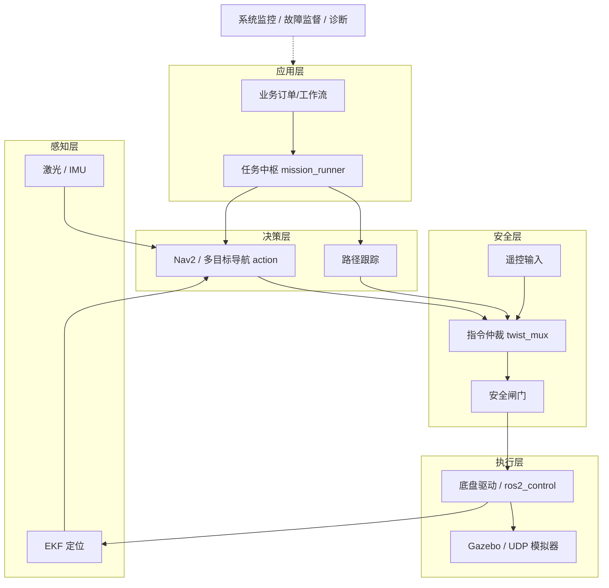

# ROS2_AMR

基于 ROS 2 Jazzy 的室内自主移动机器人（AMR）系统，覆盖从底盘通信、传感器标准化、
安全仲裁、诊断监控，到 Nav2/SLAM 导航、路径跟踪、任务调度（站点/设施/充电/车队/订单）
与 Gazebo 仿真可视化演示的完整链路。

**设计目标**：每层只做一件事，层间只通过明确定义的接口通信；纯算法与 ROS 代码分离，
可单测；同一个功能只有一条合法调用路径。



## 1. 工程结构

18 个包按「接口 / 硬件 / 感知 / 安全 / 导航 / 任务 / 仿真 / 编排」分组：

| 分组 | 包 | 职责 |
|---|---|---|
| 接口 | `robot_interfaces_core` / `_navigation` / `_mission` / `_facility` / `_fleet` / `_business` / `_site` | 94 个 msg/srv/action 契约，按域拆分，纯 IDL |
| 硬件 | `robot_hardware` | 协议编解码、传输后端、运动学、系统适配、ros2_control 插件 |
| 模型 | `robot_description` | URDF/xacro、几何参数、RViz 配置 |
| 感知 | `robot_sensors` | 激光过滤、IMU 解析与滤波、扫描模拟 |
| 安全 | `robot_teleop` | 速度指令仲裁 + 安全闸门（`/cmd_vel` 唯一发布者） |
| 基础设施 | `robot_utils` | 数学/时间工具、话题常量、系统监控、故障监督 |
| 导航 | `robot_navigation` / `robot_path_tracking` | Nav2/SLAM/地图与区域语义；Pure Pursuit / Stanley |
| 任务 | `robot_tasks` | 订单路由、任务队列、站点序列、设施协同、恢复策略 |
| 仿真 | `robot_simulation` | Gazebo 场景、桥接、平面里程计、可视化与演示编排 |
| 评测 | `robot_experiments` | 跟踪误差采集与 CSV/JSON 输出 |
| 编排 | `robot_bringup` | 顶层 launch、整机参数、启动/规范门禁测试 |

### 代码分层约定

每个包内部的 `include/<包名>/` 与 `src/` 使用相同的子目录命名，读目录即可看出分层：

| 子目录 | 含义 |
|---|---|
| `model/` | 数据模型与静态目录（catalog、队列、载荷、事件日志） |
| `workflow/` | 业务流程编排（任务生命周期、站点序列、充电、恢复） |
| `behavior/` | 行为树节点，组合工作流与导航动作 |
| `policy/` | 规则与决策（预检、恢复策略） |
| `routing/` | 入口路由（订单类型 → 处理链） |
| `report/` | 对外快照与统计视图 |
| `protocol/` `transport/` `kinematics/` `system/` `ros/` | 硬件包的编解码、通信、算法、适配、插件 |
| `mux/` `safety/` `input/` | 安全包的多路仲裁、安全闸门、输入设备 |
| `core/` `filters/` | 纯算法与几何/数据过滤（不依赖 ROS，可单测） |
| `gazebo/` `demo/` `laser/` `imu/` `sim/` | 仿真桥接、展示编排、各类传感器实现 |
| `math/` `config/` | 通用工具与常量 |
| `nodes/` | 可执行入口（`main` + 订阅/参数/定时器） |
| `impl/` | 节点的分段实现细节（编译单元内部） |

原则：`nodes/` 只做装配，算法放 `core/`，流程放 `workflow/`，数据放 `model/`；
单文件不超过 1500 行，命名与目录结构由 `tools/check_conventions.py` 强制校验。

## 1. 环境

- Ubuntu 24.04 LTS、ROS 2 Jazzy
- C++17、CMake ≥ 3.20、colcon、ament_cmake
- 依赖：`nav2_bringup`、`slam_toolbox`、`robot_localization`、`twist_mux`、`behaviortree_cpp`、`ros_gz_sim`、`ros_gz_bridge`、`laser_filters`、`xacro`、`controller_manager`、`diff_drive_controller`、`diagnostic_aggregator`

## 2. 构建

```bash
source /opt/ros/jazzy/setup.bash
# 若构建时提示 No module named 'em'，把系统 dist-packages 加入 PYTHONPATH
export PYTHONPATH=/usr/lib/python3/dist-packages:$PYTHONPATH
colcon build --base-paths src --symlink-install
source install/setup.bash
```

> 建议始终带 `--base-paths src`，确保只扫描本工程的包。

只构建部分包：

```bash
colcon build --base-paths src --symlink-install --packages-select robot_hardware robot_tasks
```

## 3. 运行

```bash
source install/setup.bash

# 1) mock 底盘 + 传感器 + 安全链 + 诊断（最小闭环）
ros2 launch robot_bringup bringup.launch.py backend:=mock

# 2) 仅模型与 TF
ros2 launch robot_bringup display.launch.py

# 3) 路径跟踪对比（pure_pursuit / stanley）
ros2 launch robot_bringup tracking.launch.py controller:=pure_pursuit

# 4) 一键自动仿真演示（Gazebo + RViz + 自动任务链）
ros2 launch robot_bringup amr_demo.launch.py gui:=true use_rviz:=true
ros2 launch robot_bringup amr_demo.launch.py gui:=false use_rviz:=false   # headless
```

mock 闭环快速验证：

```bash
ros2 topic echo /chassis/state --once          # backend: mock, connected: true
ros2 topic pub -r 20 /cmd_vel/teleop geometry_msgs/msg/Twist "{linear: {x: 0.2}}"
ros2 topic echo /odom --once                    # 位置持续推进
```

### 无显示器 / 无 GPU 环境

Gazebo 需要可用的 3D 渲染上下文。无 GPU 的服务器请启动 VNC 虚拟桌面并 `export DISPLAY=:1`，
或使用 `gui:=false`（服务端仍需要渲染传感器，headless 启动已加 `--headless-rendering`）。
若机器完全无 3D（如部分虚拟机），仿真运行时用例会自动跳过；其余功能
（mock 链路、导航配置、任务逻辑）不受影响。

### ros2_control 链路

```bash
ros2 launch robot_hardware ros2_control_hardware.launch.py backend:=mock
ros2 control list_controllers
ros2 launch robot_hardware hardware_ekf.launch.py backend:=mock
ros2 launch robot_hardware chassis_simulator.launch.py bind_host:=127.0.0.1 port:=19000
```

## 4. 测试

```bash
colcon test --base-paths src
colcon test-result --verbose
python3 tools/check_conventions.py            # 命名/行数规范
python3 tools/check_conventions.py --strict   # 发布门禁（行数超限也算失败）
```

当前基线：**534 个测试、0 失败、1 跳过**（跳过的为 Gazebo 运行时用例，需要 3D 显示）。
命名规范检查已作为 `conventions` 用例接入 `colcon test`，无需单独执行也可被门禁覆盖。

业务链路端到端冒烟（mock 底盘 + 任务中枢）：

```bash
tools/smoke_mission.sh          # 提交订单→暂停→恢复→操作员快照，末尾输出 SMOKE PASSED
```

## 5. 接口约定

| 类别 | 示例 |
|---|---|
| 命令链 | `/cmd_vel/nav2`、`/cmd_vel/tracking`、`/cmd_vel/teleop` → `/cmd_vel/muxed` → `/cmd_vel` |
| 底盘 | `/chassis/state`、`/chassis/odom_path`、`/odom`、`/wheel/odom` |
| 安全/系统 | `/system/emergency_stop`、`/system/health`、`/system/fault_state`、`/teleop/active_source` |
| 导航 | `/navigation/map_state`、`/navigation/safety_state`、`/navigation/localization_health`、`/navigation/current_goal` |
| 任务/业务 | `/mission/state`、`/facility/payload_state`、Action `/mission/navigate_sequence` |
| 服务 | `/chassis/set_mode`、`/chassis/clear_odometry`、`/mission/enqueue`、`/facility/reserve_resource`、`/business/submit_order`、`/navigation/list_maps`、`/site/activate` |

完整清单见 `需求文档.md` 附录 B/C。

## 6. 目录速查

```text
src/
├── robot_interfaces_core|navigation|mission|facility|fleet|business|site
│                          # 纯 IDL 包：msg/ srv/ action/
├── robot_hardware/        # protocol/ transport/ kinematics/ system/ ros/ nodes/
├── robot_description/     # urdf/ config/ rviz/
├── robot_sensors/         # src/laser/ src/imu/ src/sim/
├── robot_teleop/          # src/mux/ src/safety/ src/input/ + include/.../safety/
├── robot_utils/           # include/.../math/ include/.../config/ + src/nodes/
├── robot_navigation/      # model/ filters/ nodes/ + config/ maps/ launch/
├── robot_path_tracking/   # core/ nodes/ + test/
├── robot_tasks/           # model/ workflow/ behavior/ policy/ routing/ report/ nodes/ impl/
├── robot_simulation/      # core/ gazebo/ demo/ + worlds/ media/ rviz/
├── robot_experiments/     # nodes/ + paths/ results/
└── robot_bringup/         # launch/ config/ test/
```

每个包的详细分层、接口与启动方式见该包目录下的 `README.md`。

## 7. 命名与代码规范

- topic/service/action：`/<域>/<名称>`，不带版本/序号前缀
- 类型/函数 `PascalCase`；变量/成员 `snake_case`（成员尾下划线）
- ROS 句柄：`*_publisher`、`*_subscription`、`*_service`、`*_client`、`*_timer`
- 一个消息类型只在一个接口包中定义，不复制定义
- `include/` 与 `src/` 子目录同名同构，单文件 ≤ 1500 行

源码注释采用 Doxygen 风格（`@file` / `@brief` / `@details` / `@param` / `@return`）

