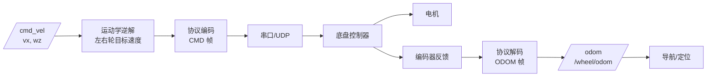

# robot_hardware 零基础教程：从底盘原理到代码逐行

> 适用对象：没有机器人/嵌入式基础，但会一点 Linux 命令行、能看懂简单 C++ 的读者。
> 目标：读完本文，你不仅能看懂 `robot_hardware` 每一层在做什么，还能自己跑通
> mock、UDP 模拟器、ros2_control 三条链路，独立排查“车不动 / 方向反 / 里程计漂”
> 这类最常见的问题。
>
> 对照代码版本：`/home/lz/robot_ws`（ROS 2 Jazzy，2026-11-25）。
> 配套文档：`src/robot_hardware/README.md`（包速查）、`docs/需求文档.md`（接口契约）、
> `docs/问题清单.md`（已知缺陷）、`docs/robot_sensors零基础教学.md`（传感器篇）。

---

## 目录

1. [底盘与机器人基础](#1-底盘与机器人基础)
2. [运动学：轮子怎么让车动](#2-运动学轮子怎么让车动)
3. [里程计：从轮速到位姿](#3-里程计从轮速到位姿)
4. [通信与协议：字节怎么变成命令](#4-通信与协议字节怎么变成命令)
5. [ros2_control：ROS 2 的标准硬件抽象](#5-ros2_controlros-2-的标准硬件抽象)
6. [`robot_hardware` 包全景](#6-robot_hardware-包全景)
7. [逐层精读](#7-逐层精读)
8. [配置与启动](#8-配置与启动)
9. [跑起来：从 mock 到真实协议](#9-跑起来从-mock-到真实协议)
10. [调试手册：症状 → 原因 → 命令](#10-调试手册症状--原因--命令)
11. [已知局限与改进路线](#11-已知局限与改进路线)
12. [自测题（附答案）](#12-自测题附答案)
13. [术语表](#13-术语表)
14. [一页速查](#14-一页速查)

---

## 1. 底盘与机器人基础

### 1.1 一台 AMR 底盘由什么组成

AMR（Autonomous Mobile Robot，自主移动机器人）的底盘，本质是“**让车按指令移动**”
的一套机电系统：

```text
上位机（ROS 2）
   │  速度指令 /cmd_vel
   ▼
主控 / 工控机 ──串口或网口──▶ 电机驱动器 ──▶ 电机 ──▶ 轮子
   ▲                                              │
   │  里程计、电池、状态                            │
   └────────────── 编码器 / 底盘控制器 ◀───────────┘
```

| 部件 | 作用 | 在本项目里的对应 |
|---|---|---|
| 驱动轮 | 提供前进/转向动力 | `left_wheel_joint`、`right_wheel_joint` |
| 随动轮（万向轮） | 支撑车体、被动转向 | URDF 的 `caster_wheel` |
| 电机 + 减速器 | 把电变成转动 | 由底盘控制器内部管理 |
| 编码器 | 测轮子转了多少 | 底盘回传的 `ODOM` 帧 |
| 电机驱动器/底盘控制器 | 接收速度命令、闭环控制电机 | 本包通过串口/UDP 通信的“底盘” |
| 主控 | 跑 ROS 2、发指令、收数据 | `chassis_driver_node` 或 `ros2_control` |

**关键认知**：ROS 2 并不直接控制电机。`robot_hardware` 做的是“**翻译 + 适配**”：
把 ROS 的速度指令翻译成底盘能听懂的协议帧，再把底盘回传的字节翻译成 ROS 消息。

### 1.2 三种常见底盘构型

| 构型 | 轮子 | 能否横移 | 能否原地转 | 复杂度 | 本项目 |
|---|---|---|---|---|---|
| **差速（differential drive）** | 左右两个驱动轮 + 万向轮 | 不能 | 能 | 低 | ✅ 主力 |
| **麦轮（mecanum）** | 四个 45° 辊子轮 | 能 | 能 | 中 | ✅ 运动学支持 |
| 舵轮（steering drive） | 驱动 + 转向电机 | 能（有限） | 能 | 高 | ❌ 未实现 |

> 差速底盘像坦克：左轮快、右轮慢就右转；两轮反向就原地转。
> 这是本项目默认、也是 `ros2_control` 链路唯一支持的构型。

### 1.3 必须先记住的几何量与单位

| 名称 | 符号 | 本项目默认值 | 单位 |
|---|---|---|---|
| 轮子直径 | $D$ | 0.15 m | m |
| 轮子半径 | $r = D/2$ | 0.075 m | m |
| 轮距（左右轮中心距） | $W$ | 0.43 m | m |
| 轴距（前后轮中心距） | $L$ | 0.42 m | m（麦轮用） |

单位约定（ROS REP-103）：

- 线速度：m/s；角速度：rad/s；轮速：RPM（转/分钟）或 rad/s。
- 长度：m；角度：rad。
- 坐标系：x 向前、y 向左、z 向上；yaw 逆时针为正。

**轮速与线速度的换算**（后面代码里反复出现）：

轮子转一圈走过的距离 = 周长 $\pi D$。所以：

$$
\text{RPM} = \frac{v}{\pi D}\times 60
\qquad\Longleftrightarrow\qquad
v = \frac{\text{RPM}}{60}\pi D
$$

角速度与 RPM：

$$
\omega\ (\text{rad/s}) = \frac{2\pi \cdot \text{RPM}}{60}
$$

**例子**：$D=0.15$ m、$v=0.2$ m/s：

$$
\text{RPM} = \frac{0.2}{3.14159\times 0.15}\times 60 = 25.46
$$

这也是本项目实测 `/chassis/state` 里 `wheels_rpm=25.464791` 的来源。

### 1.4 一个常见的误解：RPM 不是“轮子每分钟转多少圈”这么简单

- 有的电机手册给的是**电机轴 RPM**，经过减速器后轮子 RPM 会小很多；
- 本项目协议里的 RPM 一律指**轮子**转速；
- 如果你的底盘回传的是编码器计数而不是 RPM，需要先换算（本项目当前不支持非恒等编码器缩放，见 7.4）。

### 1.5 底盘的控制闭环



注意：**开环指令与闭环反馈是两条独立的路**。你发 0.2 m/s，底盘实际可能因为打滑、
电池电压、负载而只走 0.18 m/s。反馈值必须来自编码器/底盘，而不是“把指令抄一遍”。

### 1.6 坐标系与 TF

| frame | 含义 | 谁发布（本项目） |
|---|---|---|
| `odom` | 里程计原点（开机位置） | 驱动节点 / EKF / diff_drive_controller |
| `base_footprint` | 车体在地面的投影 | 同上 |
| `base_link` | 车体中心 | `robot_state_publisher`（URDF 固定关节） |
| `left_wheel_joint` / `right_wheel_joint` | 轮子关节 | `robot_state_publisher` + `joint_state_broadcaster` |

**不变量**：`odom → base_footprint` 在任一时刻只能有一个发布者。常见错误是
“驱动节点、EKF、ros2_control 控制器”同时发布，导致 TF 树抖动、定位乱跳。

### 1.7 安全与健壮性（本项目特别关注）

真实底盘通信会遇到：拔线、丢包、串口缓冲满、收到半帧、数值溢出、NaN。
一个合格的硬件层必须做到：

- 非法帧**丢弃并重同步**，不能让解析器崩；
- 非有限速度（NaN/Inf）在入口拦截；
- 串口写必须**整帧写完**，不能短写；
- 链路长时间读失败要**上报 ERROR**，而不是假装正常；
- 里程计清零要**下发到底盘**，不能只清本地。

这些点在 `robot_hardware` 里都有对应的代码，后面逐层讲。

---

## 2. 运动学：轮子怎么让车动

运动学分两部分：

- **逆解（inverse kinematics）**：已知车体速度 $(v_x, v_y, \omega_z)$，求每个轮子转速；
- **正解（forward kinematics）**：已知每个轮子转速，求车体速度。

`robot_hardware` 两个方向都实现了（`EstimateWheelSpeeds` / `EstimateChassisCommand`）。

### 2.1 差速底盘

两个驱动轮左右对称，轮距 $W$。

```text
        前
   ┌───────────┐
   │           │
   ●───────────●   左轮 L、右轮 R，间距 W
   │           │
   └───────────┘
```

**逆解**：

$$
v_L = v_x - \omega_z \frac{W}{2},\qquad
v_R = v_x + \omega_z \frac{W}{2}
$$

**正解**：

$$
v_x = \frac{v_L + v_R}{2},\qquad
\omega_z = \frac{v_R - v_L}{W}
$$

**例子**（$W=0.43$）：

- 直行 $v_x=0.2,\ \omega_z=0$ → $v_L=v_R=0.2$ m/s → 两轮 25.46 RPM。
- 右转 $v_x=0.2,\ \omega_z=0.5$：
  - $v_L = 0.2 - 0.5\times0.215 = 0.0925$ m/s → 11.78 RPM
  - $v_R = 0.2 + 0.1075 = 0.3075$ m/s → 39.16 RPM
- 原地逆时针转 $v_x=0,\ \omega_z=0.5$：
  - $v_L=-0.1075$ m/s（反转），$v_R=+0.1075$ m/s。

**转弯半径**：$R = v_x/\omega_z$。当 $\omega_z=0$ 时是直线；当 $v_x=0$ 时是原地转。

### 2.2 麦轮底盘

麦轮（mecanum）每个轮子周围有 45° 辊子，四个轮子的速度组合可以产生横向速度。
本项目采用的轮序是：

```text
0 = 左前(FL)   1 = 右前(FR)
2 = 左后(RL)   3 = 右后(RR)
```

代码里的逆解（注意：$r_{rot}=(L+W)/2$，$L$ 轴距、$W$ 轮距）：

$$
\begin{aligned}
v_{FL} &= v_x - v_y - \omega_z r_{rot}\\
v_{FR} &= v_x + v_y + \omega_z r_{rot}\\
v_{RL} &= v_x + v_y - \omega_z r_{rot}\\
v_{RR} &= v_x - v_y + \omega_z r_{rot}
\end{aligned}
$$

正解：

$$
\begin{aligned}
v_x &= \frac{v_{FL}+v_{FR}+v_{RL}+v_{RR}}{4}\\
v_y &= \frac{-v_{FL}+v_{FR}+v_{RL}-v_{RR}}{4}\\
\omega_z &= \frac{-v_{FL}+v_{FR}-v_{RL}+v_{RR}}{4 r_{rot}}
\end{aligned}
$$

> 不同厂家的辊子方向（左旋/右旋）会导致符号不同。本项目采用上面这套约定，
> 接真机时如果发现“横移方向反了”，先核对轮子安装方向，再改符号。

**例子**（$L=0.42, W=0.43 \Rightarrow r_{rot}=0.425$）：
$v_x=0.3, v_y=0.1, \omega_z=0.2$：

- $v_{FL}=0.3-0.1-0.085=0.115$ m/s
- $v_{FR}=0.3+0.1+0.085=0.485$ m/s
- $v_{RL}=0.3+0.1-0.085=0.315$ m/s
- $v_{RR}=0.3-0.1+0.085=0.285$ m/s

### 2.3 代码里的两个“正/逆解”

`src/kinematics/kinematics.cpp`：

- `EstimateWheelSpeeds(command, model, D, L, W)`：车体速度 → 四个轮 RPM；
- `EstimateChassisCommand(speeds, model, D, L, W)`：四个轮 RPM → 车体速度。

差速情况下，代码把后轮填成与前轮相同（`[L, R, L, R]`），因为差速车物理上只有两个驱动轮。
麦轮才真正使用四个独立轮速。

### 2.4 模型名必须精确

代码只接受 `diff_drive` 和 `mecanum`，其它字符串直接抛异常：

```cpp
throw std::invalid_argument("Unsupported chassis model: ...");
```

这是刻意设计：**宁可在启动时明确报错，也不要静默降级成差速**，否则车会按错误的
运动学跑，现场很难发现。

---

## 3. 里程计：从轮速到位姿

### 3.1 为什么需要里程计

GPS 在室内不可用，激光定位需要初值，导航需要知道“我现在大概在哪”。
里程计通过积分轮子转速，给出**短时间内的相对位姿**：

- 优点：高频、连续、不依赖外部环境；
- 缺点：会漂移（打滑、轮径误差、积分误差会累积）。

所以真实系统里，里程计用于短时估计，激光/地图定位用于长期纠偏（EKF/AMCL）。

### 3.2 离散积分公式

在采样周期 $\Delta t$ 内，假设车体速度不变：

$$
\begin{aligned}
x_{k+1} &= x_k + (v_x\cos\theta_k - v_y\sin\theta_k)\Delta t\\
y_{k+1} &= y_k + (v_x\sin\theta_k + v_y\cos\theta_k)\Delta t\\
\theta_{k+1} &= \theta_k + \omega_z \Delta t
\end{aligned}
$$

其中 $\theta_k$ 是**区间起点**的航向角。代码里就是 `IntegratePose()`：

```cpp
result.x_m += (command.linear_x_mps * cos_yaw -
               command.linear_y_mps * sin_yaw) * dt;
result.y_m += (command.linear_x_mps * sin_yaw +
               command.linear_y_mps * cos_yaw) * dt;
result.yaw_rad = pose.yaw_rad + command.angular_z_radps * dt;
result.yaw_rad = std::atan2(std::sin(result.yaw_rad), std::cos(result.yaw_rad));
```

最后一步把航向角归一化到 $[-\pi,\pi]$，否则长时间转圈后数值会无限增大。

> **关于“起点还是中点”**：更精确的做法是用区间中点的航向
> $\theta_k + \omega_z\Delta t/2$ 做积分，能减小转弯时的误差。
> 但本仓库当前实际使用的是**起点航向**（与既有标定/实验数据一致）。
> 代码里原来的注释误写成“中点”，现已更正——读代码时以实际语句为准。

**例子**：$v_x=0.2,\ \omega_z=0.5,\ \Delta t=0.02$ s，从 $(0,0,0)$ 开始：
每周期 $x$ 增加 0.004 m，yaw 增加 0.01 rad；1 秒后约 $x\approx0.2$ m、yaw≈0.5 rad。

### 3.3 为什么轮式里程计与底盘里程计会不一样

本项目同时发布两条里程计：

| 话题 | 含义 | 来源 |
|---|---|---|
| `/wheel/odom` | 纯轮速积分（从 0 开始） | 驱动节点把轮速做正解后积分 |
| `/odom` | 底盘反馈的位姿（mock 下也是积分） | 底盘协议里的 `ODOM` |

两者在理想情况下接近，但：

- 起点不同、开始积分的时间不同；
- 轮径/轮距误差会以不同方式放大；
- 底盘内部可能已经做了自己的滤波/积分。

EKF 用 `/wheel/odom` 作为 odom0、`/imu/data` 作为 imu0，再融合成更平滑的
`/odometry/filtered`（本仓库 `hardware_ekf.launch.py` 重映射为 `/odom`）。

### 3.4 里程计清零为什么必须下发到底盘

如果只清本地变量：

1. 驱动本地位姿 → 0；
2. 下一帧底盘 `ODOM` 回来，又写成旧位姿；
3. 表现为“清零后马上跳回去”。

所以 `Adapter::SendClearOdometry()` 会先发协议清零命令（文本 `CLEAR\n` 或
Mick `0xE1` 帧），成功后才复位本地状态。**模拟器也必须实现清零**，否则
UDP 链路会复现同样的问题（本次已修复，见第 11 节）。

---

## 4. 通信与协议：字节怎么变成命令

### 4.1 串口 vs UDP

| 维度 | 串口（serial） | UDP |
|---|---|---|
| 物理层 | USB/RS232/RS485 | 以太网/WiFi |
| 数据形态 | **字节流**（无边界） | **数据报**（有边界，但会丢/乱序） |
| 典型设备 | 单片机、驱动器 | 工控机、远程底盘 |
| 本项目后端 | `SerialBackend` | `UdpBackend` |

串口是字节流，所以必须自己“找帧边界”（换行符或帧头帧尾）；UDP 虽然保留报文边界，
但一条报文里也可能有多帧，或者一帧跨多条报文（取决于对端实现），所以解析器仍然要
按流处理。

### 4.2 文本协议（本项目默认）

一拍一条，以 `\n` 结尾，字段用空格分隔：

| 方向 | 格式 | 说明 |
|---|---|---|
| 上位机 → 底盘 | `CMD vx vy wz\n` | 严格 3 个参数 |
| 上位机 → 底盘 | `CLEAR\n` | 里程计清零 |
| 底盘 → 上位机 | `ODOM x y yaw vx wz [battery]\n` | 5 或 6 个数值 |
| 底盘 → 上位机 | `STATE status [battery]\n` | 状态 + 可选电压 |

示例：

```text
CMD 0.2000 0.0000 0.5000
ODOM 1.2340 0.5000 0.7854 0.2000 0.1000 23.80
STATE running 23.80
CLEAR
```

优点：可读、好调试、用 `nc`/串口助手就能看。
缺点：占带宽、解析慢、没有校验（只能靠格式约束）。

### 4.3 二进制协议（Mick）

帧结构：

```text
AE EA | LEN | TYPE | DATA... | CHECKSUM | EF FE
```

- `AE EA`：帧头；
- `LEN`：TYPE + DATA + CHECKSUM 的总字节数，即 `len(DATA) + 2`；
- `CHECKSUM`：从 `LEN` 开始累加到 DATA 最后一个字节，取低 8 位；
- `EF FE`：帧尾。

支持的帧类型（本仓库实现）：

| TYPE | 方向 | DATA | 含义 |
|---|---|---|---|
| `0xF3` | 上位机→底盘 | 6 字节 | 速度命令：vx(mm/s)、vy(mm/s)、wz(mrad/s)，各 int16 大端 |
| `0xE1` | 上位机→底盘 | 4 字节 | 清零里程计：`01 00 00 00` |
| `0xA1` | 底盘→上位机 | 14 字节 | 里程计：x/y/yaw/vx/vy/wz（int16，/1000）+ 电压（uint16，/100） |
| `0xA2` | 底盘→上位机 | 1 或 3 字节 | 状态码（0=运行，非 0=故障）+ 可选电压 |

**为什么用大端（big-endian）**：网络字节序，跨平台一致。x86 是小端，所以代码里
手动把高字节放前面、低字节放后面。

**示例**：`vx=0.2 m/s, vz=0.5 rad/s` 的 `0xF3` 帧：

- DATA：`00 C8`（200 mm/s）、`00 00`（vy=0）、`01 F4`（500 mrad/s）
- LEN = 6 + 2 = 8
- CHECKSUM = (0x08+0xF3+0x00+0xC8+0x00+0x00+0x01+0xF4) & 0xFF = 0xB8
- 完整帧：`AE EA 08 F3 00 C8 00 00 01 F4 B8 EF FE`（13 字节）

### 4.4 半包、粘包与重同步

串口一次 `read()` 可能读到：

- 半帧：`AE EA 08 F3 00`；
- 一帧半：`... EF FE AE EA 08`；
- 一堆噪声：`12 34 AE EA ...`。

所以解析器必须：

1. 把新字节追加到缓冲区；
2. 循环寻找完整帧；
3. 不完整就保留，等下一次数据；
4. 校验失败只丢一个字节，重新找帧头（不能整段丢弃，否则会吃掉真帧头）；
5. 缓冲区有上限，防止垃圾数据撑爆内存。

`BinaryPacketStream` 和 `PacketStream` 分别实现了文本/二进制的这套状态机。

### 4.5 为什么协议层要严格

代码对 `CMD` 要求**恰好 3 个参数**、`ODOM` 要求 **5 或 6 个数值**，
多一个少一个都拒收。原因：

- 宽松解析会把“旧格式/坏数据”悄悄当成合法命令，导致车乱动；
- 严格解析能让问题在测试阶段就暴露，而不是上路后才出现。

---

## 5. ros2_control：ROS 2 的标准硬件抽象

### 5.1 为什么需要 ros2_control

如果每个底盘都写一个“订阅 /cmd_vel、发协议、发 /odom”的节点，会有大量重复代码。
`ros2_control` 把硬件抽象成**标准接口**：

```text
controller_manager（50 Hz 循环）
   ├── diff_drive_controller（控制器：TwistStamped → 左右轮速度）
   │        │ command interface: left/right_wheel_joint/velocity
   │        ▼
   ├── 硬件组件（SystemInterface：本项目的 ChassisHardwareInterface）
   │        │ 读写真实底盘（串口/UDP/Mock）
   │        ▼
   └── joint_state_broadcaster（把状态接口发成 /joint_states）
```

### 5.2 三个核心概念

| 概念 | 解释 | 本项目的例子 |
|---|---|---|
| **状态接口（StateInterface）** | 硬件告诉控制器“现在是什么状态” | 轮子位置、轮子速度 |
| **命令接口（CommandInterface）** | 控制器告诉硬件“要怎么做” | 左右轮目标角速度 |
| **生命周期** | 硬件组件要经过 `on_init → on_configure → on_activate` | 打开串口、创建 Adapter |

### 5.3 与“独立驱动节点”的区别

| 维度 | 独立驱动节点 | ros2_control |
|---|---|---|
| 入口 | `chassis_driver_node` | `ros2_control_node` + controller |
| 速度话题 | `/cmd_vel`（`geometry_msgs/Twist`） | `<controller>/cmd_vel`（Jazzy 下是 `TwistStamped`） |
| 里程计话题 | `/odom`、`/wheel/odom` | `<controller>/odom` |
| TF | 驱动节点发布 | 控制器发布 |
| 适用 | 简单部署、调试、无控制器需求 | 需要标准控制器/多硬件统一管理 |

**不要同时跑两条链路**，否则 `/odom`、TF、`/joint_states` 都会有多个发布者。

### 5.4 本项目为什么两个都保留

- 独立驱动节点：启动简单，直接对接 `bringup.launch.py`，任务/安全链路都按 `/cmd_vel` 设计；
- ros2_control：面向标准化扩展（换控制器、加真实硬件、统一生命周期）。

两条链路共用同一套协议层、传输层、运动学、适配器——这正是五层架构的价值。

### 5.5 Jazzy 的一个重要细节（实测）

ROS 2 Jazzy 的 `diff_drive_controller`：

- 订阅的是 `/<controller_name>/cmd_vel`，类型为 `geometry_msgs/msg/TwistStamped`；
- 发布 `/<controller_name>/odom`；
- 旧参数 `use_stamped_vel` 已不再生效（配置文件里的值会被忽略）。

本项目的 `ros2_control_hardware.launch.py` 目前**没有**把项目统一的 `/cmd_vel`
（Twist）转成 `TwistStamped` 再送进控制器，所以：

- 控制器能加载、能激活；
- 但直接发 `/cmd_vel` 不会让控制器动；
- 需要手动发 `TwistStamped` 到 `/diff_drive_controller/cmd_vel` 验证硬件链路（见第 9 节）。

这是当前代码的真实状态，学习时要分清“硬件插件工作正常”和“上层话题已接通”两件事。

---

## 6. `robot_hardware` 包全景

### 6.1 五层架构

```text
┌──────────────────────────────────────────────┐
│ 节点层 nodes/                                │
│  chassis_driver_node / chassis_simulator_node│
│  odom_path_recorder_node                     │
├──────────────────────────────────────────────┤
│ ROS 适配层 ros/                              │
│  ChassisHardwareInterface (SystemInterface)  │
├──────────────────────────────────────────────┤
│ 系统适配层 system/                           │
│  Adapter：连接态、指令、里程计、流解析        │
├──────────────────────────────────────────────┤
│ 运动学层 kinematics/                         │
│  RPM↔m/s、差速/麦轮正逆解、位姿积分           │
├──────────────────────────────────────────────┤
│ 传输层 transport/                            │
│  Backend 抽象：Mock / Serial / UDP           │
├──────────────────────────────────────────────┤
│ 协议层 protocol/                             │
│  文本 CMD/ODOM/STATE/CLEAR + Mick 二进制      │
└──────────────────────────────────────────────┘
```

依赖方向**只能向下**：协议层不知道 ROS，运动学不知道串口，Adapter 不知道话题。
这样每一层都能单测（本包有 3 个 gtest 文件）。

### 6.2 目录与产物

```text
robot_hardware/
├── include/robot_hardware/
│   ├── protocol/packet.hpp
│   ├── transport/{backend,backend_factory,mock_backend,serial_backend,udp_backend}.hpp
│   ├── kinematics/kinematics.hpp
│   ├── system/adapter.hpp
│   └── ros/hardware_interface.hpp
├── src/
│   ├── protocol/packet.cpp
│   ├── transport/{backend_factory,mock_backend,serial_backend,udp_backend}.cpp
│   ├── kinematics/kinematics.cpp
│   ├── system/adapter.cpp
│   ├── ros/hardware_interface.cpp
│   └── nodes/{chassis_driver_node,chassis_simulator_node,odom_path_recorder_node}.cpp
├── config/                # 标定、控制器、EKF
├── launch/                # 4 个 launch
├── robot_hardware_plugins.xml
└── test/                  # 协议/运动学/适配器/插件测试
```

构建产物：

| 产物 | 类型 | 作用 |
|---|---|---|
| `robot_hardware_backends` | 共享库 | 协议 + 传输 + 运动学 + 适配器 |
| `robot_chassis_hardware` | 共享库（插件） | ros2_control `SystemInterface` 实现 |
| `chassis_driver_node` | 可执行 | 独立驱动节点 |
| `chassis_simulator_node` | 可执行 | UDP 底盘模拟器 |
| `odom_path_recorder_node` | 可执行 | 里程计轨迹录制 |

### 6.3 两条运行链路

```mermaid
flowchart TB
  subgraph driver["独立驱动链路"]
    A[/cmd_vel Twist/] --> B[chassis_driver_node]
    B --> C[Adapter]
    C --> D[Backend: mock/serial/udp]
    D --> E[底盘固件/模拟器]
    B --> F[/odom /wheel/odom /chassis/state/]
    B --> G[TF odom→base_footprint（可选）]
    B --> H[/imu/data 合成（mock 可选）/]
  end

  subgraph rc["ros2_control 链路"]
    I[/diff_drive_controller/cmd_vel<br/>TwistStamped/] --> J[diff_drive_controller]
    J --> K[ChassisHardwareInterface]
    K --> L[Adapter]
    L --> D
    J --> M[/diff_drive_controller/odom/]
    J --> N[TF odom→base_footprint]
  end

  subgraph ekf["EKF 链路"]
    F --> O[robot_localization EKF]
    H --> O
    O --> P[/odom（重映射）/ + TF]
  end
```

### 6.4 接口总表

话题：

| 话题 | 类型 | 发布者 | 说明 |
|---|---|---|---|
| `/cmd_vel` | `geometry_msgs/Twist` | 安全闸门 | 独立驱动链路的输入 |
| `/odom` | `nav_msgs/Odometry` | driver / EKF | 绝对位姿 |
| `/wheel/odom` | `nav_msgs/Odometry` | driver | 轮速积分位姿 |
| `/chassis/odom_path` | `nav_msgs/Path` | odom recorder | 轨迹 |
| `/chassis/state` | `robot_interfaces_core/ChassisState` | driver | 连接/后端/电压/轮速 |
| `/imu/data` | `sensor_msgs/Imu` | driver（mock 合成） | EKF 输入 |

服务：

| 服务 | 类型 | 作用 |
|---|---|---|
| `/chassis/set_mode` | `robot_interfaces_core/SetChassisMode` | 切换运动学模型（仅 mock 允许） |
| `/chassis/clear_odometry` | `std_srvs/Empty` | 清零位姿（下发到底盘） |
| `/chassis/reset_odom_path` | `std_srvs/Empty` | 清空轨迹缓存 |

插件：

| 插件名 | 类型 | 说明 |
|---|---|---|
| `robot_hardware/ChassisHardwareInterface` | `hardware_interface::SystemInterface` | ros2_control 硬件组件 |

参数（`chassis_driver_node`）：

| 参数 | 默认值 | 说明 |
|---|---|---|
| `backend` | `mock` | `mock`/`serial`/`udp` |
| `chassis_type` | `diff_drive` | `diff_drive`/`mecanum` |
| `publish_tf` | `true` | 是否发 `odom→base_footprint` |
| `publish_odom` | `true` | 是否发 `/odom` |
| `odom_topic` / `wheel_odom_topic` | `/odom` / `/wheel/odom` | 话题名 |
| `serial_device` / `serial_baud` | `/dev/ttyUSB0` / 115200 | 串口 |
| `udp_host` / `udp_port` | `192.168.1.10` / 9000 | UDP |
| `protocol` | `text` | `text`/`mick_binary` |
| `wheel_diameter_m` | 0.15 | 轮径 |
| `wheel_base_m` | 0.42 | 轴距（麦轮） |
| `track_width_m` | 0.43 | 轮距 |
| `io_timeout_ms` | 500 | 多久没新包算断连 |
| `imu_source` | `auto` | mock 下合成 IMU |

---

## 7. 逐层精读

### 7.1 协议层 `protocol/packet.hpp` / `packet.cpp`

#### 7.1.1 四个数据结构

```cpp
struct Command {           // 车体速度指令
  double linear_x_mps;
  double linear_y_mps;
  double angular_z_radps;
};

struct OdometryPacket {    // 底盘回传的位姿
  double x_m, y_m, yaw_rad;
  double linear_x_mps, linear_y_mps, angular_z_radps;
  std::optional<double> battery_voltage;
};

struct StatePacket {       // 状态 + 可选电压
  std::string status;
  std::optional<double> battery_voltage;
};

struct Packet {            // 统一容器
  PacketKind kind;         // kOdometry / kState
  OdometryPacket odometry;
  StatePacket state;
};
```

`std::optional` 表示“这个字段可能没有”。文本协议里电池是可选的，所以用 optional 很合适。

#### 7.1.2 文本编码

```cpp
std::string EncodeCommand(const Command &command) {
  oss << std::fixed << std::setprecision(4)
      << "CMD " << vx << ' ' << vy << ' ' << wz << '\n';
}
```

- 固定 4 位小数：日志/抓包可读，精度足够（0.1 mm、0.0001 rad/s）；
- 非有限值先 `SanitizeFinite` 成 0，避免把 `nan` 写进协议；
- `EncodeOdometry` 不写 `vy`（文本协议固定 `x y yaw vx wz`）；
- `EncodeClearOdometryCommand()` 返回 `"CLEAR\n"`。

#### 7.1.3 文本解码

```cpp
if (!(iss >> tag >> command.linear_x_mps)) return std::nullopt;
if (tag != "CMD") return std::nullopt;
// 继续读剩下的参数
std::vector<double> values;
...
if (values.size() != 2U) return std::nullopt;   // 总共必须 3 个
```

- `CMD` 必须 3 个参数；
- `ODOM` 前 4 个必填，后面 1~2 个（wz、可选电池）；
- `STATE` 状态字符串 + 可选电池；
- 任何字段非有限、数量不对、标签不认识 → `nullopt`；
- `TrimCarriageReturn` 兼容 Windows 的 `\r\n`。

#### 7.1.4 文本流解析 `PacketStream`

```cpp
buffer_.append(data, size);              // 累积
while ((newline = buffer_.find('\n')) != npos) {
  line = buffer_.substr(0, newline);     // 取一行
  buffer_.erase(0, newline + 1);         // 从缓冲删除
  if (auto p = DecodePacket(line)) packets.push_back(*p);
  else ++invalid_line_count_;
}
```

- 最后一行没有 `\n` 时保留在缓冲区，等下一次；
- 缓冲区超过 `max_buffer_size`（默认 4096）直接清空并置 `overflowed_`；
- 无效行只计数，不抛异常。

#### 7.1.5 Mick 二进制编码

```cpp
frame = AE EA | LEN | TYPE | DATA | CHECKSUM | EF FE
LEN = DATA.size() + 2
checksum = sum(frame[2..LEN+2-1]) & 0xFF
```

`EncodeMickSpeedCommand`：

```cpp
AppendInt16(data, lround(clamp(vx * 1000)));   // mm/s
AppendInt16(data, lround(clamp(vy * 1000)));
AppendInt16(data, lround(clamp(wz * 1000)));   // mrad/s
return EncodeBinaryFrame(0xF3, data);
```

- `EncodeInt16Checked` 把非有限值变 0，超范围饱和到 int16 范围（-32768~32767），避免抛异常；
- 大端写入。

`EncodeMickClearOdometryCommand()`：`0xE1` + `{01 00 00 00}`。

#### 7.1.6 Mick 解码

- `0xA1`：必须 14 字节；
  - x/y/yaw/vx/vy/wz：前 12 字节，各 int16 /1000；
  - 电池：后 2 字节 uint16 /100。
- `0xA2`：1 或 3 字节；
  - 状态码 0 → `"running"`，非 0 → `"fault"`；
  - 3 字节时后 2 字节是电压 /100。
- 其它类型/长度 → `nullopt`（上层计为无效帧）。

#### 7.1.7 二进制流解析 `BinaryPacketStream`

关键步骤：

1. 搜索 `AE EA`；
2. 找不到时保留末尾可能是半个帧头的 `AE`；
3. 找到后检查 `LEN ≥ 2`；
4. 数据不够就等下一次；
5. 检查帧尾 `EF FE`；
6. 重新计算校验和；
7. 校验失败只丢 1 字节重同步；
8. 成功后提取 `TYPE` 和 `DATA`，再交给 `DecodeMickBinaryPacket`。

这比文本解析复杂，但能处理任意切分和噪声。

### 7.2 传输层 `transport/`

#### 7.2.1 `Backend` 抽象

```cpp
class Backend {
  virtual std::string Name() const = 0;
  virtual BackendKind Kind() const = 0;
  virtual bool Open(std::string *error) = 0;
  virtual void Close() = 0;
  virtual bool IsOpen() const = 0;
  virtual bool WriteCommand(const Command&, std::string*) = 0;
  virtual std::optional<std::string> Read(std::string*) = 0;
  virtual bool WriteRawFrame(const std::vector<uint8_t>&, std::string*);
};
```

设计要点：

- `Kind()` 返回枚举，内部判断不用字符串比较；
- `Read()` 返回 `nullopt` 表示“当前没数据”，不是错误；
- `WriteRawFrame` 有默认实现（返回不支持），只有需要发送非速度帧的后端才覆盖；
- 虚析构保证通过基类指针删除时不漏析构。

#### 7.2.2 工厂

```cpp
if (backend == "mock") return make_unique<MockBackend>();
if (backend == "serial") return make_unique<SerialBackend>(config);
if (backend == "udp") return make_unique<UdpBackend>(config);
throw invalid_argument("Unsupported chassis backend ...");
```

**不允许静默回退到 mock**。拼错 `backend:=udpp` 会直接启动失败，而不是“看起来能跑”。

#### 7.2.3 Mock 后端

- `Open` 置标志；
- `WriteCommand` 记录最后指令；
- `Read` 返回固定字符串（在当前 Adapter 的 mock 分支里其实不会被调用）；
- `WriteRawFrame` 直接成功（用于清零）。

#### 7.2.4 串口后端（重点）

打开参数：

```cpp
open(device, O_RDWR | O_NOCTTY | O_NONBLOCK);
```

- `O_NOCTTY`：不要让它成为控制终端；
- `O_NONBLOCK`：读不到数据时立即返回，不阻塞 ROS 定时器。

配置（`termios`）：

```cpp
cfmakeraw(&tty);              // 原始模式：不做行缓冲/回显/特殊字符处理
cfsetispeed/cfsetospeed(115200);
tty.c_cflag |= CLOCAL | CREAD;
tty.c_cflag &= ~PARENB;      // 无校验
tty.c_cflag &= ~CSTOPB;      // 1 位停止位
tty.c_cflag &= ~CSIZE;
tty.c_cflag |= CS8;          // 8 位数据
tty.c_cc[VMIN] = 0;
tty.c_cc[VTIME] = 1;
```

即常见的 **8N1、115200**。

**读**：

```cpp
bytes_read = read(fd_, buffer, 512);
if (bytes_read < 0) {
  if (errno == EAGAIN || errno == EWOULDBLOCK || errno == EINTR)
    return nullopt;          // 没数据/被信号打断，不是故障
  ...真实错误...
}
```

**写（短写）**：

```cpp
while (written_total < size) {
  written = write(fd_, data + written_total, size - written_total);
  if (written > 0) { written_total += written; continue; }
  if (errno == EAGAIN) { poll(POLLOUT, 100ms); ... }
  if (errno == EINTR) continue;
  return false;
}
```

串口发送缓冲满时，`write` 可能只写一部分。**必须循环写满**，否则底盘收到半帧会解析失步。

#### 7.2.5 UDP 后端

- `socket(AF_INET, SOCK_DGRAM | SOCK_NONBLOCK)`；
- `sendto` 发到配置的 `udp_host:udp_port`；
- `recvfrom` 一次收一条数据报（最多 512 字节）；
- `EAGAIN/EWOULDBLOCK` 视为“暂时没数据”。

UDP 不保证送达，所以真实产品通常会加序号/重传/心跳；本项目用 `io_timeout_ms`
判断“多久没收到包算断连”。

### 7.3 运动学层 `kinematics/`

#### 7.3.1 数据结构与校验

```cpp
struct Pose2D { double x_m, y_m, yaw_rad; };
struct WheelSpeeds { std::array<double, 4> rpm; };  // FL, FR, RL, RR
```

所有入口都会校验：

- 位姿、速度必须是有限值；
- 轮径、轮距、轴距必须有限且 > 0；
- `dt` 必须有限且 ≥ 0。

校验失败抛 `std::invalid_argument`。节点层会捕获（驱动 `main`、hardware interface
的 `write`），不让异常穿出 ROS 回调。

#### 7.3.2 轮速换算

```cpp
WheelRpmFromLinear(v, D) = v / (πD) * 60
WheelLinearFromRpm(rpm, D) = rpm / 60 * πD
```

#### 7.3.3 差速与麦轮

就是第 2 节的公式。代码里差速把四轮填成 `[left, right, left, right]`；
麦轮使用 `(L+W)/2` 作为旋转半径。

#### 7.3.4 位姿积分

```cpp
Pose2D IntegratePose(pose, command, dt);
```

- 用起点 yaw；
- 支持横向速度（麦轮）；
- yaw 归一化到 `[-π, π]`。

### 7.4 系统适配层 `system/adapter`

#### 7.4.1 `Config` 与 `Snapshot`

`Config` 是“怎么算”：运动学模型、协议、几何、标定；
`Snapshot` 是“现在是什么”：连接状态、位姿、速度、轮速、电压、包序号。

#### 7.4.2 配置校验（会拦住很多现场错误）

```cpp
calibration_profile 不能为空
protocol ∈ {text, mick_binary}
wheel_diameter_m / wheel_base_m / track_width_m > 0 且有限
encoder_scale > 0 且有限
direction_sign ∈ {-1, +1}
并且：scale/sign 目前必须是恒等（1.0 / +1）
```

最后一条很重要：当前后端回传的是**车体里程计**，不是原始编码器计数，所以
`left_encoder_scale=1.2` 这类修正会被显式拒绝，而不是悄悄忽略。
`docs/需求文档.md` 的 RK-08 记录了这个限制。

#### 7.4.3 打开 / 关闭 / 读 / 写

- `Open()`：打开后端；mock 直接置 `connected=true`；
- `Read(dt)`：
  - mock：用 `command_` 积分出位姿（不需要真实硬件）；
  - 其它：从后端读字节，交给文本/二进制流解析，再 `ApplyPacket`；
  - 返回 `ok && connected`；
- `Write(command)`：
  - 检查后端打开；
  - **拦截 NaN/Inf**；
  - 非麦轮把 `linear_y` 清 0；
  - 调后端 `WriteCommand`，成功后保存 `command_`。

#### 7.4.4 `ApplyPacket` 做了什么

收到 `ODOM`：

- 覆盖 `x/y/yaw/vx/wz`；
- **把 `linear_y` 置 0**（即使二进制帧里有 vy）；
- 用正解从 `vx/wz` 算四轮 RPM；
- 有电池就更新；
- `packet_sequence++`、`connected=true`。

收到 `STATE`：

- 更新 `hardware_status`、电池；
- `packet_sequence++`、`connected=true`。

> 已知限制：麦轮真实底盘的横向速度 `vy` 在这一步被丢弃，导致真实链路下
> `/odom` 的横向运动信息不完整（mock 链路不受影响）。见第 11 节。

#### 7.4.5 里程计清零

```cpp
SendClearOdometry():
  按协议生成 CLEAR 文本 或 0xE1 二进制帧
  backend_->WriteRawFrame(frame)
  成功后 ResetOdometry()   // 本地 x/y/yaw/速度/轮速全清零
```

注意：**先下发，成功后才清本地**。如果底盘不支持 `CLEAR`，会返回失败并告警。

### 7.5 ROS 适配层 `ros/hardware_interface`

#### 7.5.1 生命周期

| 回调 | 做什么 |
|---|---|
| `on_init` | 从 `HardwareInfo` 读参数、校验关节名/顺序 |
| `on_configure` | 创建 Backend + Adapter，打开通信 |
| `on_activate` | 下发零速，准备接收控制器命令 |
| `on_deactivate` | 下发零速，关闭通信 |
| `read` | 读底盘 → 更新轮子状态接口 |
| `write` | 轮子命令 → 车体速度 → 写底盘 |

#### 7.5.2 参数读取

`ros2_control` 的参数不是 ROS 参数，而是 URDF 里 `<param name="..." value="..."/>`
字符串。代码用 `ParameterAsDouble/Int/String` 解析：

- 缺参数 → 用 fallback；
- 格式错 → 返回 NaN/`nullopt` → `on_init` 返回 ERROR。

#### 7.5.3 关节校验

```cpp
info_.joints.size() == 2
info_.joints[0].name == "left_wheel_joint"
info_.joints[1].name == "right_wheel_joint"
```

顺序反了也会报错——因为命令接口是按数组下标绑定的，顺序错会导致左右轮指令互换。

#### 7.5.4 `chassis_type` 只支持 `diff_drive`

虽然 Adapter/驱动节点支持麦轮，但 ros2_control 插件只导出两个轮子接口，
所以 `chassis_type != diff_drive` 会直接 `on_init` 失败。这是刻意限制。

#### 7.5.5 `read()` 的错误处理

- `Adapter::Read` 返回 false 且 error 非空 → 失败计数 +1；
- 连续 10 次（约 200 ms）→ 返回 `ERROR`，并把轮速置 0（冻结积分）；
- 成功一次 → 计数清零。

这样 `controller_manager` 能感知链路断开，而不是继续用旧数据漂移。

#### 7.5.6 `write()` 的错误处理

```cpp
try {
  command = WheelCommandsToChassisCommand();   // 可能抛异常
} catch (const std::exception& e) {
  return ERROR;                                 // 不让异常穿出 update 循环
}
if (!adapter_->Write(command, &error)) return ERROR;
```

#### 7.5.7 插件导出

```cpp
PLUGINLIB_EXPORT_CLASS(
    robot_hardware::ChassisHardwareInterface,
    hardware_interface::SystemInterface)
```

没有这一行，`controller_manager` 加载插件会失败。`robot_hardware_plugins.xml`
负责把类名映射到库。

### 7.6 节点 `chassis_driver_node`

#### 7.6.1 启动流程

1. 声明参数；
2. `NormalizeModel(chassis_type)`（非法直接 FATAL 退出）；
3. 校验 Adapter 配置；
4. `CreateBackend` + `Adapter`；
5. 打开后端；
6. 创建订阅/发布/服务；
7. 启动 20 ms（50 Hz）定时器。

#### 7.6.2 定时器做什么

```text
ReadChassisSystem()      // 读底盘，更新 connected
IntegrateWheelOdometry() // 轮速正解 + 积分 → /wheel/odom
PublishOdometry()        // /odom、/wheel/odom、TF
PublishImu()             // mock 下合成
PublishState()           // /chassis/state
```

#### 7.6.3 连通性判断

```cpp
connected_ = backend_open_ &&
             (now - last_packet_stamp_) <= io_timeout_ms_;
```

（`mock` 后端没有真实回包，代码直接令 `connected_ = read_ok`。）

`last_packet_stamp_` 只在 `packet_sequence` 变化时更新（即真的收到新包）。
所以“串口打开着但底盘不发数据”会被判为 `connected=false`。

#### 7.6.4 `/chassis/set_mode`

- 参数必须是 `diff_drive`/`mecanum`；
- 只有 **mock** 后端允许运行时切换；
- 真实硬件返回失败，要求启动时通过 `chassis_type` 配好。

#### 7.6.5 合成 IMU（mock）

`imu_source=auto` 且 `backend=mock` 时：

- `orientation`：用当前 yaw 构造四元数；
- `angular_velocity.z`：当前角速度；
- `linear_acceleration.x`：速度差分；
- 其它分量 0。

真实后端不会合成 IMU（应由真实 IMU 或 `robot_sensors` 提供）。

#### 7.6.6 里程计清零

```cpp
ResetOdometry():
  adapter_->SendClearOdometry(&error);   // 下发协议清零
  system_state_ = adapter_->State();     // 同步快照
  wheel_x_ = wheel_y_ = wheel_yaw_ = 0;  // 本地轮式积分清零
```

### 7.7 节点 `chassis_simulator_node`

作用：**假装自己是一台底盘**，用于无硬件联调。

- 绑定 UDP 端口（默认 `0.0.0.0:9000`）；
- 收到 `CMD` 文本 → 更新指令；
- 20 ms 定时用 `IntegratePose` 积分位姿；
- 每个周期回发 `ODOM ...` + `STATE ...`；
- 收到 `CLEAR` → 位姿和指令清零（本次修复）；
- 只支持**文本协议**；`protocol:=mick_binary` 时它无法解析二进制命令（已知限制）。

> 实战用法：driver `backend:=udp udp_host:=127.0.0.1 udp_port:=19000`
> + simulator `bind_host:=127.0.0.1 port:=19000`，本机闭环，不接真硬件。

### 7.8 节点 `odom_path_recorder_node`

- 订阅 `/odom`，按最小距离（默认 0.02 m）抽样；
- 保存最多 `max_poses`（默认 2000）个点；
- 每 `publish_period_ms` 发布一次 `/chassis/odom_path`；
- 服务 `/chassis/reset_odom_path` 清空。

注意：`hardware.launch.py` 把 `output_topic` 覆盖成了 `/odom/path`，
而包默认和 `robot_bringup` 用的是 `/chassis/odom_path`。看 RViz 时不要找错话题。

---

## 8. 配置与启动

### 8.1 `config/chassis_calibration.yaml`

```yaml
chassis_driver_node:
  ros__parameters:
    calibration_profile: nominal_reference
    wheel_diameter_m: 0.15
    wheel_base_m: 0.42
    track_width_m: 0.43
    left_encoder_scale: 1.0
    right_encoder_scale: 1.0
    left_direction_sign: 1
    right_direction_sign: 1
```

两种用法：

1. `hardware.launch.py` 直接把它作为 `chassis_driver_node` 的参数文件
   （顶层键必须等于节点名）；
2. `ros2_control_hardware.launch.py` 把它传给 xacro，URDF 读取
   `chassis_driver_node.ros__parameters` 后写入 `<ros2_control><hardware><param>`。

所以控制侧改标定值只需要改这一份文件；但务必同步检查
`robot_description/config/robot_geometry.yaml`（URDF/仿真也用同一组轮径、轮距），
避免“控制器按 0.15 m、模型按别的尺寸”这种不一致。

### 8.2 `config/ros2_control_controllers.yaml`

```yaml
controller_manager:
  ros__parameters:
    update_rate: 50
    joint_state_broadcaster:
      type: joint_state_broadcaster/JointStateBroadcaster
    diff_drive_controller:
      type: diff_drive_controller/DiffDriveController

diff_drive_controller:
  ros__parameters:
    left_wheel_names: ["left_wheel_joint"]
    right_wheel_names: ["right_wheel_joint"]
    wheel_separation: 0.43
    wheel_radius: 0.075
    base_frame_id: base_footprint
    odom_frame_id: odom
    cmd_vel_timeout: 0.5
    publish_odom_tf: true
```

- `wheel_radius` 是半径 0.075（与 `wheel_diameter_m=0.15` 一致）；
- `cmd_vel_timeout=0.5`：超过 0.5 s 没收到速度指令就刹车；
- Jazzy 的 `diff_drive_controller` 订阅 `TwistStamped`，旧的 `use_stamped_vel` 已移除。

### 8.3 `config/ekf.yaml`

- `odom0=/wheel/odom`：用 vx、vy、vyaw；
- `imu0=/imu/data`：用 yaw、vyaw、ax；
- `publish_tf=true`：EKF 发布 `odom→base_footprint`；
- 所以 EKF 链路必须让 driver `publish_tf=false, publish_odom=false`。

### 8.4 四个 launch

| launch | 启动内容 | 适用 |
|---|---|---|
| `hardware.launch.py` | driver + odom recorder + fake_scan | 独立驱动、mock/UDP/串口 |
| `hardware_ekf.launch.py` | driver（不发 odom/TF）+ EKF + recorder + fake_scan | EKF 融合 |
| `chassis_simulator.launch.py` | UDP 底盘模拟器 | 无硬件联调 |
| `ros2_control_hardware.launch.py` | robot_state_publisher + controller_manager + 两个 spawner | ros2_control |

`hardware.launch.py` 里有一个 `sensor_source` 参数，声明了但当前没有使用——
无论传什么都会启动 `fake_scan_node`。这是已知清理项。

---

## 9. 跑起来：从 mock 到真实协议

### 9.1 构建与测试

```bash
cd ~/robot_ws
source /opt/ros/jazzy/setup.bash
export PYTHONPATH=/usr/lib/python3/dist-packages:$PYTHONPATH
colcon build --base-paths src --packages-select robot_hardware
source install/setup.bash

colcon test --base-paths src --packages-select robot_hardware
colcon test-result --test-result-base build/robot_hardware
```

测试文件对应关系：

| 测试 | 覆盖 |
|---|---|
| `chassis_packet_test` | 文本/二进制编解码、流解析、运动学 |
| `chassis_system_adapter_test` | 配置校验、mock 积分、读写、清零 |
| `chassis_hardware_interface_test` | 插件生命周期、参数/关节校验 |

### 9.2 实验一：mock 闭环（最常用）

```bash
# 终端 A
ros2 launch robot_hardware hardware.launch.py backend:=mock

# 终端 B：持续发 0.2 m/s
ros2 topic pub -r 20 /cmd_vel geometry_msgs/msg/Twist "{linear: {x: 0.2}}"

# 终端 C
ros2 topic echo /odom --once --field pose.pose.position
ros2 topic echo /wheel/odom --once --field pose.pose.position
ros2 topic echo /chassis/state --once
```

实测（约 5 秒后）：

```text
/odom      x ≈ 1.12
/wheel/odom x ≈ 1.62
/chassis/state:
  backend: mock
  connected: true
  battery_voltage: 24.0
  linear_velocity: 0.2
  status: running:velocity:wheels_rpm=25.464791,25.464791,25.464791,25.464791
```

两个里程计数值不完全相同是正常的：它们是两条独立的积分（起点/时机不同），
不要拿它们当“必须相等”的断言。

**注意**：`chassis_driver_node` 没有 `/cmd_vel` 超时兜底，停止发布后它会继续执行
最后一条指令。零速保护由上游 `cmd_vel_safety_gate_node` 负责。单独测试时记得手动发零速：

```bash
ros2 topic pub --once /cmd_vel geometry_msgs/msg/Twist "{}"
```

### 9.3 实验二：里程计清零

```bash
ros2 service call /chassis/clear_odometry std_srvs/srv/Empty "{}"
ros2 topic echo /odom --once --field pose.pose.position
# x/y/z 都回到 0（mock 下瞬时生效）
```

### 9.4 实验三：UDP 模拟器闭环

```bash
# 终端 A：模拟底盘
ros2 launch robot_hardware chassis_simulator.launch.py bind_host:=127.0.0.1 port:=19000

# 终端 B：驱动连到模拟器
ros2 run robot_hardware chassis_driver_node --ros-args \
  -p backend:=udp -p udp_host:=127.0.0.1 -p udp_port:=19000 -p publish_tf:=false

# 终端 C：发指令
ros2 topic pub -r 20 /cmd_vel geometry_msgs/msg/Twist "{linear: {x: 0.2}}"

# 终端 D：观察 + 清零
ros2 topic echo /odom --once --field pose.pose.position
ros2 service call /chassis/clear_odometry std_srvs/srv/Empty "{}"
ros2 topic echo /odom --once --field pose.pose.position
```

实测：清零前约 `x=0.788`，清零后 `x=0.0`（本次修复了模拟器对 `CLEAR` 的处理）。
如果没修复，清零后会看到 `x` 继续增大甚至跳回旧值。

### 9.5 实验四：ros2_control 链路

```bash
# 启动控制器
ros2 launch robot_hardware ros2_control_hardware.launch.py backend:=mock

# 另开终端
ros2 control list_controllers
ros2 node info /diff_drive_controller
```

你会看到：

- `joint_state_broadcaster`、`diff_drive_controller` 都是 active；
- 控制器订阅 `/diff_drive_controller/cmd_vel`，类型 **TwistStamped**；
- 控制器发布 `/diff_drive_controller/odom` 和 `/tf`。

手动驱动（注意话题和类型）：

```bash
ros2 topic pub -r 20 /diff_drive_controller/cmd_vel \
  geometry_msgs/msg/TwistStamped "{twist: {linear: {x: 0.2}}}"

ros2 topic echo /diff_drive_controller/odom --once --field pose.pose.position
# 实测约 x=1.088（约 5.4 秒）
```

这说明“硬件插件 + 控制器 + mock 底盘”是通的。当前 launch 还没有把项目统一的
`/cmd_vel`（Twist）转成 `TwistStamped`，所以直接发 `/cmd_vel` 不会动——这是
第 11 节列出的集成缺口。

### 9.6 实验五：EKF 链路

```bash
ros2 launch robot_hardware hardware_ekf.launch.py backend:=mock
ros2 topic hz /odom
ros2 run tf2_tools view_frames
```

该 launch：

- driver `publish_tf=false`、`publish_odom=false`；
- EKF 订阅 `/wheel/odom` + `/imu/data`，输出重映射到 `/odom`；
- EKF 发布 `odom→base_footprint`。

用 `view_frames` 确认只有一个 TF 源；不要同时启动 `bringup.launch.py`。

### 9.7 实验六：自己写一个假底盘（文本协议）

这个实验能让你彻底理解“协议层”在干什么。写一个 Python UDP 服务：

```python
# /tmp/fake_chassis.py
import math
import socket

sock = socket.socket(socket.AF_INET, socket.SOCK_DGRAM)
sock.bind(("127.0.0.1", 19001))
x = y = yaw = 0.0
vx = vy = wz = 0.0
dt = 0.02

while True:
    data, addr = sock.recvfrom(1024)
    for line in data.decode(errors="ignore").splitlines():
        if line.startswith("CMD "):
            _, vx_s, vy_s, wz_s = line.split()
            vx, vy, wz = float(vx_s), float(vy_s), float(wz_s)
        elif line == "CLEAR":
            x = y = yaw = 0.0

    x += (vx * math.cos(yaw) - vy * math.sin(yaw)) * dt
    y += (vx * math.sin(yaw) + vy * math.cos(yaw)) * dt
    yaw += wz * dt
    reply = (
        f"ODOM {x:.4f} {y:.4f} {yaw:.4f} {vx:.4f} {wz:.4f} 23.8\n"
        f"STATE running 23.8\n"
    )
    sock.sendto(reply.encode(), addr)
```

```bash
# 终端 A
python3 /tmp/fake_chassis.py

# 终端 B
ros2 run robot_hardware chassis_driver_node --ros-args \
  -p backend:=udp -p udp_host:=127.0.0.1 -p udp_port:=19001 -p publish_tf:=false

# 终端 C
ros2 topic pub -r 20 /cmd_vel geometry_msgs/msg/Twist "{linear: {x: 0.2}, angular: {z: 0.1}}"
ros2 topic echo /odom --once --field pose.pose.position
```

这个脚本就是 `chassis_simulator_node` 的简化版。把它改成回 `STATE fault` 或
故意发坏帧，可以测试驱动的容错。

### 9.8 实验七：构造 Mick 二进制帧

用 Python 手工拼一帧 `0xF3`（vx=0.2 m/s、wz=0.5 rad/s）：

```python
import struct

def frame_0xF3(vx, vy, wz):
    data = struct.pack(">hhh", int(vx * 1000), int(vy * 1000), int(wz * 1000))
    length = len(data) + 2
    checksum = (length + 0xF3 + sum(data)) & 0xFF
    return bytes([0xAE, 0xEA, length, 0xF3]) + data + bytes([checksum, 0xEF, 0xFE])

print(frame_0xF3(0.2, 0.0, 0.5).hex(" "))
# ae ea 08 f3 00 c8 00 00 01 f4 b8 ef fe
```

把这段字节作为 UDP 报文发给你自己的假底盘，就能验证 `protocol:=mick_binary` 的编码。
反向（解析 `0xA1`/`0xA2`）可以写一个假底盘回包，练习大端、/1000 与 /100 的换算。

---

## 10. 调试手册：症状 → 原因 → 命令

### 10.1 车不动 / 里程计不动

| 检查 | 命令 | 期望 |
|---|---|---|
| 节点在不在 | `ros2 node list` | `chassis_driver_node` |
| 后端开没开 | `ros2 topic echo /chassis/state --once` | `backend`、`connected` |
| 有没有收到指令 | `ros2 topic hz /cmd_vel` | 有频率 |
| 底盘有没有回包 | `ros2 topic hz /odom` | 有频率 |
| 串口权限 | `ls -l /dev/ttyUSB0`、`groups` | 在 `dialout` 组 |
| UDP 对端 | `ss -lunp \| grep 9000` | 模拟器在监听 |
| 协议拼错 | 启动日志 | `protocol must be one of ...` |

### 10.2 方向反了 / 转向反了

| 现象 | 可能原因 | 处理 |
|---|---|---|
| 发正速度车后退 | 电机接线反 / 编码器符号反 | 交换电机线或调整 `direction_sign`（当前只接受 ±1） |
| 发正角速度右转 | 轮子左右装反 | 交换左右轮定义（要同步 URDF 与标定） |
| 麦轮横移反 | 辊子方向/轮序约定不同 | 核对轮序 FL/FR/RL/RR |
| 原地转但轨迹画圈 | 左右轮速比例不对 | 检查 `track_width_m` |

### 10.3 里程计尺度不对（走 1 m 显示 1.2 m）

- 轮径参数错（`wheel_diameter_m` 是直径不是半径）；
- 减速比/编码器线数没换算；
- 打滑（地面、轮胎磨损）；
- 当前代码拒绝非恒等 `encoder_scale`，所以不能靠该参数修尺度。

### 10.4 连接状态异常

- `connected=false` 但串口已打开：底盘没回包，或 `io_timeout_ms` 太小；
- `/chassis/state.status` 里 `backend_unavailable`：后端没打开；
- `wheels_rpm` 全 0：没收到有效 `ODOM`，或底盘处于急停。

### 10.5 串口/协议问题

| 症状 | 原因 | 说明 |
|---|---|---|
| 日志刷 `Resource temporarily unavailable` | 旧代码把 EAGAIN 当错误 | 现已修复 |
| 间歇性丢指令 | 串口短写 | 现已循环写满 + poll |
| 二进制帧全部无效 | 波特率/帧头/校验/字节序不对 | 用 9.8 的脚本对照 |
| 文本帧全部无效 | 少了 `\n` / 字段数不对 | `CMD` 必须 3 个参数 |
| 收到半帧后卡住 | 解析器没保留半包 | 本项目会保留并等待 |

### 10.6 ros2_control 问题

| 症状 | 原因 | 处理 |
|---|---|---|
| 插件加载失败 | 缺 `PLUGINLIB_EXPORT_CLASS`/xml 未安装 | `ros2 control list_hardware_components` |
| `on_init` 失败 | 关节名/顺序不对、`chassis_type!=diff_drive`、参数非法 | 看 controller_manager 日志 |
| 控制器不 active | spawner 失败、硬件未激活 | `ros2 control list_controllers` |
| 发 `/cmd_vel` 不动 | 控制器订阅的是 `/diff_drive_controller/cmd_vel`（TwistStamped） | 用 9.5 的命令验证 |
| 里程计话题找不到 | 控制器发布 `/diff_drive_controller/odom` | 或用 remap |
| TF 重复 | 同时跑了 driver 和 controller | 只保留一个 TF 源 |

### 10.7 清零无效

- 文本协议：底盘必须支持 `CLEAR`；
- 二进制协议：底盘必须支持 `0xE1`；
- 模拟器：本次已支持 `CLEAR`；
- 清零后下一帧 `ODOM` 又回跳 → 说明只清了本地，没下发成功。

---

## 11. 已知局限与改进路线

| # | 现状 | 影响 | 建议 |
|---|---|---|---|
| 1 | ros2_control launch 未把 `/cmd_vel`（Twist）接到控制器 | 控制器能激活但发 `/cmd_vel` 不动 | 增加 `Twist→TwistStamped` 转换节点并 remap，或统一改用控制器话题 |
| 2 | 控制器里程计话题是 `/diff_drive_controller/odom` | 与项目 `/odom` 不一致 | remap 或在文档/launch 中显式说明 |
| 3 | `chassis_simulator_node` 只支持文本协议 | `protocol:=mick_binary` + 模拟器无法闭环 | 增加二进制解析/回包 |
| 4 | 真实协议 `ApplyPacket` 丢弃 `linear_y` | 麦轮真实底盘横移不进 `/odom` | 保留 vy 并让轮速正解使用它 |
| 5 | `battery_voltage` 默认 24.0 | 底盘不上报电压时仍显示 24 V | 默认 0 或增加 `has_battery` |
| 6 | 非恒等 `encoder_scale/sign` 被拒绝 | 无法用软件修正编码器误差 | 后端提供原始轮速后再开放 |
| 7 | `hardware.launch.py` 的 `sensor_source` 未使用 | 误以为能切换传感器源 | 加条件分支或删除参数 |
| 8 | `hardware.launch.py` 把轨迹话题改成 `/odom/path` | 与默认 `/chassis/odom_path` 不一致 | 统一话题或文档说明 |
| 9 | 驱动节点没有 `/cmd_vel` 超时 | 上游挂掉会保持最后速度 | 依赖安全闸门；独立使用时应加超时 |
| 10 | 模拟器曾忽略 `CLEAR` | UDP 链路清零失效 | 已修复（本次） |
| 11 | `kinematics.cpp` 注释曾误写“中点积分” | 误导读者 | 已更正为“起点航向” |
| 12 | `use_stamped_vel` 参数在 Jazzy 无效 | 配置看起来能切换，实际不能 | 已删除并加注释 |

---

## 12. 自测题（附答案）

1. **轮径 0.15 m，车速 0.2 m/s，轮子 RPM 是多少？**
   答：$0.2/(\pi\times0.15)\times60 \approx 25.46$ RPM。

2. **差速车原地逆时针转，左右轮分别怎么转？**
   答：左轮反转、右轮正转（$v_L=-\omega W/2,\ v_R=+\omega W/2$）。

3. **差速正解公式？**
   答：$v_x=(v_L+v_R)/2$，$\omega=(v_R-v_L)/W$。

4. **麦轮为什么能横移？**
   答：45° 辊子把轮子的切向速度分解出横向分量，四个轮子组合产生合速度。

5. **代码用起点还是中点航向积分？**
   答：起点航向（尽管注释曾误写中点，已更正）。

6. **`/wheel/odom` 和 `/odom` 有什么区别？**
   答：前者是轮速纯积分，后者是底盘反馈位姿（mock 下也是积分）；两者起点/时机不同。

7. **`CLEAR` 为什么必须下发到底盘？**
   答：只清本地的话，下一帧底盘 `ODOM` 会把旧位姿写回来。

8. **文本 `CMD` 有几个参数？少一个会怎样？**
   答：3 个（vx vy wz）；少一个直接拒收（`nullopt`）。

9. **文本 `ODOM` 的字段顺序？**
   答：`x y yaw vx wz [battery]`，5 或 6 个数值。

10. **Mick 帧的帧头、帧尾、LEN 含义？**
    答：`AE EA` / `EF FE`；LEN = TYPE + DATA + CHECKSUM 的总字节数 = DATA 长度 + 2。

11. **Mick 校验和的范围？**
    答：从 LEN 开始累加到 DATA 最后一个字节，取低 8 位。

12. **0xA1 的电池怎么换算？**
    答：uint16 / 100，单位 V。

13. **为什么串口读要判断 EAGAIN？**
    答：非阻塞模式下“当前没数据”会返回 EAGAIN，不是故障。

14. **短写（short write）有什么危害？**
    答：底盘收到半帧会解析失步，表现为间歇性丢指令/乱动，所以必须循环写满。

15. **`Adapter::Write` 为什么要拦截 NaN/Inf？**
    答：否则下一个周期积分/运动学会抛异常，可能让驱动节点退出。

16. **`io_timeout_ms` 判断的是什么？**
    答：多久没收到新的底盘包（`packet_sequence` 不变化）就算断连。

17. **ros2_control 插件的状态接口和命令接口分别是什么？**
    答：状态是左右轮 position/velocity；命令是左右轮 velocity。

18. **为什么插件只支持 `diff_drive`？**
    答：只导出两个轮子接口，麦轮需要四个独立轮接口。

19. **控制器连续读失败多少次上报 ERROR？**
    答：10 次（约 200 ms @ 50 Hz），并冻结位置积分。

20. **Jazzy 的 diff_drive_controller 订阅什么话题/类型？**
    答：`/<controller>/cmd_vel`，`geometry_msgs/msg/TwistStamped`。

21. **为什么不能同时跑 driver、EKF、ros2_control 控制器？**
    答：会有多个 `/odom` 和 `odom→base_footprint` 发布者，TF/定位冲突。

22. **UDP 模拟器支持哪些协议？**
    答：当前只支持文本；Mick 二进制命令无法解析（已知限制）。

---

## 13. 术语表

| 术语 | 解释 |
|---|---|
| **AMR** | 自主移动机器人 |
| **差速/麦轮** | 两种底盘运动学构型 |
| **轮距（track width）** | 左右轮中心距 |
| **轴距（wheel base）** | 前后轮中心距（麦轮用） |
| **RPM** | 每分钟转数 |
| **里程计（odometry）** | 通过轮速积分估计位姿 |
| **正解/逆解** | 轮速→车体速度 / 车体速度→轮速 |
| **协议帧** | 一段有边界、有字段的二进制/文本数据 |
| **大端序** | 高字节在前 |
| **半包/粘包** | 一帧被拆开 / 多帧挤在一起 |
| **重同步** | 出错后重新寻找帧头 |
| **ros2_control** | ROS 2 的硬件抽象框架 |
| **状态/命令接口** | 硬件“报告状态”/“接收命令”的通道 |
| **controller_manager** | 周期性调用硬件读写、管理控制器生命周期 |
| **EKF** | 扩展卡尔曼滤波（多传感器融合） |
| **TF** | 坐标系变换树 |

---

## 14. 一页速查

```bash
# 构建 + 测试
colcon build --base-paths src --packages-select robot_hardware
colcon test --base-paths src --packages-select robot_hardware

# mock 闭环
ros2 launch robot_hardware hardware.launch.py backend:=mock
ros2 topic pub -r 20 /cmd_vel geometry_msgs/msg/Twist "{linear: {x: 0.2}}"
ros2 topic echo /odom --once --field pose.pose.position
ros2 topic echo /chassis/state --once

# 清零
ros2 service call /chassis/clear_odometry std_srvs/srv/Empty "{}"

# UDP 模拟器
ros2 launch robot_hardware chassis_simulator.launch.py bind_host:=127.0.0.1 port:=19000
ros2 run robot_hardware chassis_driver_node --ros-args \
  -p backend:=udp -p udp_host:=127.0.0.1 -p udp_port:=19000 -p publish_tf:=false

# ros2_control
ros2 launch robot_hardware ros2_control_hardware.launch.py backend:=mock
ros2 control list_controllers
ros2 topic pub -r 20 /diff_drive_controller/cmd_vel \
  geometry_msgs/msg/TwistStamped "{twist: {linear: {x: 0.2}}}"
ros2 topic echo /diff_drive_controller/odom --once --field pose.pose.position

# EKF
ros2 launch robot_hardware hardware_ekf.launch.py backend:=mock
ros2 run tf2_tools view_frames

# 查看参数/接口
ros2 param list /chassis_driver_node
ros2 topic info /odom -v
ros2 control list_hardware_interfaces
```

**四个最重要的认知**：

1. `robot_hardware` 是“翻译层”：ROS 速度 ↔ 协议帧 ↔ 底盘；
2. 差速逆解就两行公式，轮径/轮距是所有尺度问题的根源；
3. 里程计清零必须下发到底盘，否则下一帧会被覆盖；
4. `odom→base_footprint` 只能有一个发布者（driver、EKF、ros2_control 三选一）。

---

**文档结束**。建议顺序：第 1~5 章打基础 → 第 6 章看全景 → 第 7 章对照源码 →
第 9 章动手实验 → 第 10 章收藏排错。
