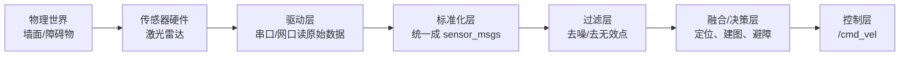
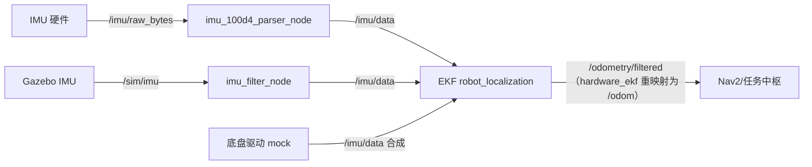
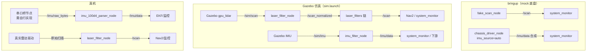

# robot_sensors 零基础教程：从传感器原理到代码逐行

> 适用对象：完全没有传感器/机器人基础，但会一点 Linux 命令行、能看懂简单 C++ 的读者。
> 目标：读完本文后，你不仅知道 `robot_sensors` 每个文件在做什么，还能自己启动、观察、
> 注入数据、定位常见故障，并理解它为什么这样设计。
>
> 对照代码版本：`/home/lz/robot_ws`（ROS 2 Jazzy，2026-11-25）。
> 其他文档：`docs/需求文档.md`（接口契约）、`docs/问题清单.md`（已知缺陷）、
> `src/robot_sensors/README.md`（包速查）。

---

## 目录

1. [先建立直觉：机器人的“感觉器官”](#1-先建立直觉机器人的感觉器官)
2. [2D 激光雷达（LiDAR）基础](#2-2d-激光雷达lidar基础)
3. [IMU（惯性测量单元）基础](#3-imu惯性测量单元基础)
4. [读懂本包所需的 ROS 2 最小知识](#4-读懂本包所需的-ros-2-最小知识)
5. [`robot_sensors` 包总览](#5-robot_sensors-包总览)
6. [逐文件精读](#6-逐文件精读)
7. [跑起来：从零开始做实验](#7-跑起来从零开始做实验)
8. [调试手册：症状 → 原因 → 命令](#8-调试手册症状--原因--命令)
9. [已知局限与改进路线](#9-已知局限与改进路线)
10. [自测题（附答案）](#10-自测题附答案)
11. [术语表](#11-术语表)
12. [一页速查](#12-一页速查)

---

## 1. 先建立直觉：机器人的“感觉器官”

### 1.1 传感器到底是什么

传感器 = **把物理世界的某种量，转换成电信号/数字数据的器件**。

| 物理量 | 传感器 | 机器人用它做什么 |
|---|---|---|
| 距离/障碍物 | 激光雷达、超声波、深度相机 | 建图、避障、定位 |
| 角速度/加速度/姿态 | IMU | 航向估计、平衡、里程计融合 |
| 轮子转了多少 | 编码器 | 里程计（走了多远） |
| 电量 | 电压采样 | 低电回桩 |
| 图像 | 相机 | 识别、视觉定位 |

本包只处理两类：**2D 激光雷达** 和 **IMU**。

### 1.2 一条完整的机器人感知链

以激光雷达为例，从“光”到“机器人拐弯”，要经过 5 层：



`robot_sensors` 负责的是 **标准化层 + 过滤层**（图中第 3、4 层）。
它**不直接读串口**（IMU 也只接收已经打包好的 `/imu/raw_bytes` 字节消息）、
**不做导航决策**、**不发速度指令**。

一句话定位：**把各式各样的传感器数据，整理成全项目统一、可信、可诊断的 ROS 消息。**

### 1.3 评价传感器的 5 个通用指标

| 指标 | 含义 | 激光雷达例子 | IMU 例子 |
|---|---|---|---|
| **量程（range）** | 能测的最小~最大范围 | 0.08 m ~ 12 m | ±16 g / ±2000 °/s |
| **分辨率** | 能区分的最小变化 | 1° 一个点、1 cm 距离分辨率 | 0.01 g、0.1 °/s |
| **采样率（频率）** | 每秒出多少数据 | 10 Hz（每秒 10 圈） | 100 Hz（每秒 100 组） |
| **噪声** | 测量值的随机波动 | ±1 cm 高斯噪声 | 零偏、白噪声 |
| **延迟** | 从发生到收到的时间 | 几十 ms | 几 ms |

**为什么必须先懂这 5 个词**：后面读代码时会不断遇到它们——
`range_min`/`range_max` 是量程，`angle_increment` 是角度分辨率，
`update_rate_hz` 是采样率，`noise_stddev_m` 是噪声。
配置里写错任何一个，导航都会“看起来能跑，实际撞墙”。

### 1.4 单位与坐标系（最重要的基础）

机器人领域有两套最容易混的单位：

- **长度**：米（m）。ROS 统一用米，不用厘米。
- **角度**：**弧度（rad）**。代码里 `-3.141592653589793` 就是 -π = -180°。
  人习惯度（°），程序习惯弧度。换算：`rad = deg * π / 180`

角度与弧度转换：  
θ = s / r  弧度 = 圆弧长度 ÷ 圆的半径  
C = 2 π r  
θ = 2 π r /r = 2π rad  
360° = 2π rad     
180° = π rad 

ROS 约定（REP-103）的坐标轴（俯视图，从上往下看）：

```text
              +x（前）
               ↑
               |
  +y（左） ←───┼───→ −y（右）
               |
               ↓
              −x（后）

  z 轴：垂直于纸面向外（向上）
  从 +x 转向 +y 的方向 = 逆时针 = yaw 正方向
```

- **yaw（偏航）**：绕 z 轴转，从 x 转向 y 为正（逆时针为正）。
- **pitch（俯仰）**：绕 y 轴。
- **roll（横滚）**：绕 x 轴。

机器人上有很多坐标系（TF frame），本包相关的有三个：

| frame | 含义 | 谁发布 |
|---|---|---|
| `base_footprint` | 车体在地面的投影点 | 底盘驱动 / EKF / 仿真 |
| `base_link` | 车体中心 | `robot_state_publisher`（URDF） |
| `lidar_link` | 激光雷达安装位置 | `robot_state_publisher`（URDF 固定关节） |
| `imu_link` | IMU 安装位置 | `robot_state_publisher`（URDF 固定关节） |

安装位置来自 `src/robot_description/config/robot_geometry.yaml`：

```yaml
sensors:
  lidar:
    frame_id: lidar_link
    parent_frame: base_link
    xyz_m: [0.18, 0.0, 0.27]   # 车体中心前方 18 cm、上方 27 cm
  imu:
    frame_id: imu_link
    parent_frame: base_link
    xyz_m: [0.0, 0.0, 0.22]     # 车体中心上方 22 cm
```

**`frame_id` 是消息里的“我这些数据是在哪个坐标系下量的”**。
如果消息声称是 `lidar_link`，但 TF 树里没有这个坐标系，RViz 和 Nav2 会直接报
`No transform from [lidar_link]`，数据等于废掉。

### 1.5 时间戳与时钟

每条 ROS 消息都带 `header.stamp`（时间戳）。它有两个作用：

1. 多传感器**时间对齐**（比如把 10:00:00.100 的激光和同一时刻的 IMU 配对）；
2. 判断数据**是否新鲜**（超过 1 秒没更新就认为传感器挂了）。

两个时钟：

- **系统时间**：`date` 看到的真实时间。
- **仿真时间**：`use_sim_time=true` 时，节点使用 Gazebo 发布的 `/clock`。

混用会导致“消息时间戳比现在早 3 年”或“EKF 一直等待未来数据”。
本包节点**不修改输入消息的时间戳**（`fake_scan_node` 和 `imu_100d4_parser_node`
用当前节点时钟生成），这是正确的做法：谁采集，谁打时间戳。

---

## 2. 2D 激光雷达（LiDAR）基础

### 2.1 它是怎么测距的

常见两种原理：

- **TOF（飞行时间）**：发一束激光，测光往返时间 $t$，距离 $d = c \cdot t / 2$
  （$c$ 是光速）。适合中远距离。
- **三角测距**：激光打在物体上，相机看光点的位置，用三角形相似关系算距离。
  近距离便宜方案常用。

2D 激光雷达内部有一个旋转部件（或转镜），让光束在水平面扫一圈，每隔固定角度
采一个点。所以一帧数据本质是：

```text
角度: -180° -179° ... 0° ... +179°
距离:  5.0   5.0  ... 1.5 ...  5.0  m
```

### 2.2 ROS 里的 `sensor_msgs/msg/LaserScan`

一条扫描消息的字段（本包 `fake_scan_node` 填的就是这些）：

```text
std_msgs/Header header          # 时间戳 + frame_id
float32 angle_min               # 第一个点的角度（rad）
float32 angle_max               # 最后一个点的角度（rad）
float32 angle_increment         # 相邻点角度差（rad）
float32 time_increment          # 相邻点时间差（s）
float32 scan_time               # 一圈耗时（s）
float32 range_min               # 有效距离下限（m）
float32 range_max               # 有效距离上限（m）
float32[] ranges                # 每个点的距离（m）
float32[] intensities           # 每个点的反射强度（可选）
```

**核心公式**（必须背下来）：

$$
\theta_i = \theta_{min} + i \cdot \Delta\theta
$$

第 $i$ 个点的角度 = 起始角 + 下标 × 角度步长。
把距离换成平面坐标（雷达自身坐标系）：

$$
x_i = r_i \cos\theta_i,\qquad y_i = r_i \sin\theta_i
$$

### 2.3 `ranges` 里的特殊值

这是初学者最容易踩的坑：

| 值 | 含义 | 应该怎么处理 |
|---|---|---|
| `inf`（无穷大） | 这个方向没有回波（打空了） | 视为“无障碍”，不要当 0 m |
| `NaN` | 无效/未测量 | 丢弃 |
| `0.0` | 通常是占位值或驱动错误 | 丢弃（小于 `range_min`） |
| 小于 `range_min` | 太近，测不准（盲区） | 丢弃 |
| 大于 `range_max` | 超量程 | 丢弃 |

本包默认把无效点改成 `inf`（参数 `invalid_range_as_inf=true`），
这是 Nav2 最喜欢的语义：**inf = 没东西**。

> 如果改成 `0.0`，代价地图会把“打空的远处”误判成“紧贴车头的障碍物”，
> 机器人会立刻急停。所以这个参数不要随便关。

### 2.4 扫描方向：逆时针 vs 顺时针（本包的重点）

ROS 约定：**下标增大，角度增大（逆时针，CCW）**。

但有些雷达（或安装方式）是**顺时针扫描**：下标 0 对应 +180°，下标增大角度减小。
如果驱动直接把数据塞进消息、却仍然写“角度递增”的元数据，整幅扫描就**左右镜像**了：
真实在左边的墙，会出现在右边。

`laser_filter_node` 用参数 `clockwise` 处理这种情况。做法是：

1. 把 `ranges` 数组反转（下标 0 ↔ 最后一个）；
2. 重写角度元数据，让每个点仍然是“下标增大角度增大”。

推导（$N$ 个点，原元数据 $\theta_{min}$、$\Delta\theta$）：

- 反转后下标 $j$ 的数据来自原下标 $N-1-j$；
- 它原本的角度是 $\theta_{min} + (N-1-j)\Delta\theta = \theta_{max} - j\Delta\theta$；
- 顺时针意味着物理角度要取反：$-(\theta_{max} - j\Delta\theta) = -\theta_{max} + j\Delta\theta$。

所以正确的新元数据是：

$$
\theta'_{min} = -\theta_{max},\qquad \Delta\theta' = \Delta\theta,\qquad
\theta'_{max} = -\theta_{min}
$$

> **本次阅读时发现并修复的问题**：原代码写成了 `angle_increment = -old_increment`
> （步长取反），用 360 点、-180°~180° 的扫描实测会得到
> `angle_min=-179°、angle_increment=-1°、angle_max=-538°`，
> 角度范围直接跑到 -538°，任何消费者都会算错。
> 修复后为 `-179° / +1° / +180°`，与推导一致。
> 这段代码在 `src/robot_sensors/src/laser/laser_filter_node.cpp` 的
> `Filter()` 里，注释已经写成上面的推导，方便你对照。

### 2.5 激光雷达的常见误差来源

| 现象 | 原因 | 后果 |
|---|---|---|
| 玻璃/镜子测不到 | 激光穿透或镜面反射 | 以为那里是空的 |
| 黑色物体测距偏近或丢点 | 反射太弱 | 障碍物位置偏移/漏检 |
| 阳光直射 | 环境光干扰 | 噪声变大/丢点 |
| 机器人运动时扫描歪斜 | 一圈扫描期间车在动 | 点云“拖影”（运动畸变） |
| 近距离盲区 | 光学结构限制 | 车头正前方 5 cm 内看不到 |

这些属于硬件/算法层面，本包只做**标准化和范围过滤**，不做运动畸变校正。

### 2.6 激光在导航里的用途

- **AMCL 定位**：拿当前扫描和地图匹配，估计机器人在哪（`nav2_basic.yaml` 的
  `scan_topic: /scan`）。
- **代价地图避障**：把扫描点写进局部/全局代价地图（`nav2_advanced.yaml` 的
  `observation_sources: scan`）。
- **恢复行为**：被挡住时后退/旋转。

所以 `/scan` 一旦断流，导航会立刻“失明”。

---

## 3. IMU（惯性测量单元）基础

### 3.1 IMU 的“三件套”

| 器件 | 测什么 | 单位 | 用途 |
|---|---|---|---|
| 加速度计 | 线加速度（含重力） | m/s² 或 g | 倾斜、短时位移、重力方向 |
| 陀螺仪 | 角速度 | rad/s 或 °/s | 转向快慢、航向积分 |
| 磁力计（可选） | 地磁场方向 | μT | 绝对航向（找北） |

可以把 IMU 理解成人的**前庭系统**（内耳）：闭眼也能感觉到头在转、身体在倾斜。
但它有两个致命缺点：

1. **积分会漂**：角速度积分得到角度，误差也一起积分，越积越大；
2. **有零偏**：静止时陀螺仪输出不完全是 0，几秒后角度就偏了。

所以真实系统里 IMU 很少单独使用，而是和轮式里程计、激光定位**融合**（EKF）。

### 3.2 姿态的表示：欧拉角 vs 四元数

**欧拉角**（人话版）：roll（横滚）、pitch（俯仰）、yaw（偏航），三个角度。
直观，但有“万向节死锁”（pitch=±90° 时 roll/yaw 分不清）。

**四元数**（程序版）：4 个数 $(x, y, z, w)$，表示“绕某个轴转某个角度”，
计算稳定、不会死锁。ROS 的 `sensor_msgs/Imu.orientation` 就是四元数。

从欧拉角（ZYX 顺序：先 yaw，再 pitch，再 roll）转四元数的公式：

$$
\begin{aligned}
q_w &= \cos\tfrac{r}{2}\cos\tfrac{p}{2}\cos\tfrac{y}{2}
     + \sin\tfrac{r}{2}\sin\tfrac{p}{2}\sin\tfrac{y}{2}\\
q_x &= \sin\tfrac{r}{2}\cos\tfrac{p}{2}\cos\tfrac{y}{2}
     - \cos\tfrac{r}{2}\sin\tfrac{p}{2}\sin\tfrac{y}{2}\\
q_y &= \cos\tfrac{r}{2}\sin\tfrac{p}{2}\cos\tfrac{y}{2}
     + \sin\tfrac{r}{2}\cos\tfrac{p}{2}\sin\tfrac{y}{2}\\
q_z &= \cos\tfrac{r}{2}\cos\tfrac{p}{2}\sin\tfrac{y}{2}
     - \sin\tfrac{r}{2}\sin\tfrac{p}{2}\cos\tfrac{y}{2}
\end{aligned}
$$

`imu_100d4_parser_node.cpp` 里的 `QuaternionFromEuler()` 就是这组公式，
你可以逐行对照（代码里用 `cr/sr/cp/sp/cy/sy` 简写 cos/sin 的 roll/pitch/yaw 半角）。

### 3.3 单位与重力

- **加速度**：ROS 规定 `linear_acceleration` 用 m/s²，不是 g。
  静止平放时，z 轴约为 **+9.80665 m/s²**（重力反作用力）。
- **角速度**：ROS 规定 `angular_velocity` 用 rad/s，不是 °/s。
  1 rad/s ≈ 57.3 °/s。

本项目的 100D4 协议里，角度按 **0.01°** 存储、加速度按 **0.001 g** 存储，
角速度按 **0.001** 存储（代码按 rad/s 解释）。这些比例因子写死在解析代码里。

### 3.4 误差从哪来

| 误差 | 表现 | 处理 |
|---|---|---|
| 零偏（bias） | 静止时陀螺仪不是 0 | 上电静止校准、EKF 估计 |
| 随机游走 | 角度缓慢漂移 | 融合绝对参考（激光/磁力计） |
| 温漂 | 跑久了零偏变化 | 温度补偿/重新校准 |
| 振动 | 高频噪声 | 低通滤波、减震安装 |
| 安装误差 | 坐标系没对齐 | 外参标定、符号修正 |

### 3.5 磁力计校准

磁力计容易被电机、金属结构干扰，需要“8 字校准”：拿着设备在空中画 8 字，
采集各个方向的磁场，拟合出硬磁/软磁偏差。

本包提供了两个服务：

```text
/sensors/imu/start_calibration   std_srvs/srv/Trigger
/sensors/imu/stop_calibration    std_srvs/srv/Trigger
```

**注意**：当前实现只把状态字符串改成 `magnetic_calibration_active` / `idle`，
并没有真正向设备下发校准命令（见 `docs/问题清单.md` P2-07）。
这是学习时要知道的“代码现状 vs 设计意图”。

### 3.6 IMU 在本项目里的用途



EKF 配置在 `src/robot_hardware/config/ekf.yaml`：

```yaml
imu0: /imu/data
imu0_config: [false, false, false,   # x, y, z
              false, false, true,    # roll, pitch, yaw  ← 用 yaw
              false, false, false,   # vx, vy, vz
              false, false, true,    # vroll, vpitch, vyaw ← 用 yaw 角速度
              true,  false, false]   # ax, ay, az ← 用 x 加速度
imu0_remove_gravitational_acceleration: true
```

也就是说：**IMU 的航向、航向角速度和前向加速度会参与融合**。

### 3.7 协方差为什么重要（代码里没填）

`sensor_msgs/Imu` 每个量都带一个 9 元协方差数组，表示“这个测量有多可信”。
全 0 表示“未知”，EKF 会用自己的默认值，融合权重可能不合理。

`imu_100d4_parser_node` 目前**没有填协方差**。接入真机做高精度定位时，
应该根据器件手册填入（例如角度 0.01 rad²、角速度 0.001 (rad/s)²）。
这是一个很好的练手改进点。

---

## 4. 读懂本包所需的 ROS 2 最小知识

### 4.1 节点、话题、消息

```text
节点（Node）  = 一个进程里干一件事的程序
话题（Topic） = 有名字的数据管道，发布者写、订阅者读
消息（Msg）   = 管道里传输的结构化数据
```

激光雷达的典型链路：

```text
fake_scan_node ──发布 /scan──▶ system_monitor / Nav2 / RViz
```

查看命令：

```bash
ros2 node list                 # 有哪些节点
ros2 topic list                # 有哪些话题
ros2 topic info /scan -v       # 谁发布、谁订阅、QoS
ros2 topic hz /scan            # 频率
ros2 topic echo /scan --once --field angle_min
```

### 4.2 参数（Parameter）

节点的可配置项，启动时可改、运行时也能改：

```bash
ros2 run robot_sensors fake_scan_node --ros-args -p topic:=/my_scan
ros2 param list /fake_scan_node
ros2 param get /laser_filter_node range_max
ros2 param set /laser_filter_node invalid_range_as_inf false
```

代码里对应：

```cpp
topic_ = declare_parameter<std::string>("topic", topics::kScan);
```

第二个参数是**默认值**，所以不传参数也能跑。

### 4.3 服务（Service）

“请求—应答”式调用，适合“执行一个动作并要结果”：

```bash
ros2 service list | grep sensors
ros2 service call /sensors/imu/start_calibration std_srvs/srv/Trigger "{}"
```

本包两个服务都是 `std_srvs/srv/Trigger`（空请求、返回 `success` + `message`）。

### 4.4 Launch 文件

一个 Python 脚本，负责“一次启动多个节点 + 传参数 + 重映射话题”：

```bash
ros2 launch robot_sensors sensors.launch.py
ros2 launch robot_sensors sensors.launch.py scan_input:=/my_scan use_laser_filters:=false
```

`sensors.launch.py` 还做了条件分支（`IfCondition` / `UnlessCondition`），
后面 6.3 节会逐段讲。

### 4.5 QoS（服务质量）

发布/订阅要“匹配”才能通信。本包全部用默认 QoS（深度 10、可靠传输）。
激光/IMU 这类高频传感器在大型系统里常改成 `SensorDataQoS`（best effort），
但**可靠发布者 + best-effort 订阅者是兼容的**，所以当前实现能正常工作。

如果遇到“话题存在但收不到数据”，先查 QoS：

```bash
ros2 topic info /scan -v
```

### 4.6 diagnostics（诊断）

ROS 的诊断系统：节点定期上报“我是否健康”，聚合器汇总成诊断树。

```text
/diagnostics            原始诊断项
/diagnostics_agg        聚合后的树（rqt_robot_monitor 看）
```

本包 `laser_filter_node` / `imu_filter_node` 各注册了一个诊断项，
名称分别是 `laser_filter`、`imu_filter`，会被
`src/robot_utils/config/diagnostic_aggregator.yaml` 归到 `/Robot/Sensors`。

### 4.7 一个最小节点骨架（背下来）

```cpp
class MyNode final : public rclcpp::Node {
 public:
  MyNode() : Node("my_node") {
    value_ = declare_parameter<double>("value", 1.0);

    subscription_ = create_subscription<sensor_msgs::msg::LaserScan>(
        "/scan", 10, [this](sensor_msgs::msg::LaserScan::SharedPtr msg) { OnScan(*msg); });

    publisher_ = create_publisher<sensor_msgs::msg::LaserScan>("/scan_out", 10);
    timer_ = create_wall_timer(std::chrono::milliseconds(100), [this]() { Tick(); });
  }

 private:
  void OnScan(const sensor_msgs::msg::LaserScan&) { /* 处理 */ }
  void Tick() { /* 周期任务 */ }

  double value_;
  rclcpp::Subscription<sensor_msgs::msg::LaserScan>::SharedPtr subscription_;
  rclcpp::Publisher<sensor_msgs::msg::LaserScan>::SharedPtr publisher_;
  rclcpp::TimerBase::SharedPtr timer_;
};

int main(int argc, char** argv) {
  rclcpp::init(argc, argv);
  rclcpp::spin(std::make_shared<MyNode>());
  rclcpp::shutdown();
  return 0;
}
```

本包四个节点都是这个结构的变体，看懂一个就看懂全部。

---

## 5. `robot_sensors` 包总览

### 5.1 职责与边界

| 做 | 不做 |
|---|---|
| 统一 `frame_id`、量程、角度方向 | 不读串口（IMU 字节流由外部桥节点送入） |
| 过滤无效点 | 不做建图/定位/避障决策 |
| 把厂商字节流解析成标准消息 | 不发 `/cmd_vel` |
| 无硬件时提供假扫描 | 不做多传感器融合（那是 EKF 的事） |
| 上报诊断 | 不改时间戳 |

### 5.2 目录与构建

```text
robot_sensors/
├── CMakeLists.txt
├── package.xml
├── README.md
├── config/
│   └── laser_filter_chain.yaml   # laser_filters 插件链参数
├── launch/
│   └── sensors.launch.py         # 激光/IMU 标准链路
└── src/
    ├── laser/laser_filter_node.cpp      # 激光标准化 + 内置过滤
    ├── imu/imu_filter_node.cpp          # IMU frame 归一化
    ├── imu/imu_100d4_parser_node.cpp    # 厂商字节流 → sensor_msgs/Imu
    └── sim/fake_scan_node.cpp           # 无硬件时的假扫描
```

构建依赖（`CMakeLists.txt`）：`rclcpp`、`sensor_msgs`、`diagnostic_msgs`、
`diagnostic_updater`、`std_msgs`、`std_srvs`、`robot_utils`。
运行期还依赖 `laser_filters`（`package.xml` 的 `exec_depend`）。

> 小细节：CMake 里还 `find_package(tf2_ros)`，但当前四个节点都没有直接使用它，
> 属于可清理的历史遗留（不影响构建）。

单独构建：

```bash
cd ~/robot_ws
source /opt/ros/jazzy/setup.bash
# 若报 No module named 'em'，先执行：
export PYTHONPATH=/usr/lib/python3/dist-packages:$PYTHONPATH
colcon build --base-paths src --packages-select robot_sensors
source install/setup.bash
```

### 5.3 四个可执行与数据流

| 可执行 | 输入 | 输出 | 一句话 |
|---|---|---|---|
| `fake_scan_node` | 无（定时器） | `/scan`（默认） | 假扫描，无硬件联调用 |
| `laser_filter_node` | `/sim/scan`（默认） | `/scan`（默认） | 激光标准化/过滤 |
| `imu_filter_node` | `/sim/imu`（默认） | `/imu/data`（默认） | IMU 换 frame 名 |
| `imu_100d4_parser_node` | `/imu/raw_bytes`（默认） | `/imu/data` + `/imu/calibration_state` | 厂商字节流解析 |

三种典型启动方式下的数据流不一样，先记住这张图：



> 重要：`imu_100d4_parser_node` 的输入 `/imu/raw_bytes` **在本仓库中没有发布者**。
> 真机部署时需要一个“串口读取 + 发布 `std_msgs/UInt8MultiArray`”的桥节点（或厂商 SDK）。
> 仿真链路不走它，而是走 Gazebo → `/sim/imu` → `imu_filter_node`。

### 5.4 接口总表

话题（`robot_utils/config/topic_names.hpp` 是唯一命名来源）：

| 话题 | 类型 | 发布者 | 订阅者 |
|---|---|---|---|
| `/sim/scan` | `sensor_msgs/LaserScan` | Gazebo 桥 | `laser_filter_node` |
| `/scan_normalized` | `sensor_msgs/LaserScan` | `laser_filter_node` | `laser_filters` |
| `/scan` | `sensor_msgs/LaserScan` | `laser_filter_node` / `laser_filters` / `fake_scan_node` | Nav2、`system_monitor_node` |
| `/sim/imu` | `sensor_msgs/Imu` | Gazebo 桥 | `imu_filter_node` |
| `/imu/data` | `sensor_msgs/Imu` | `imu_filter_node` / `imu_100d4_parser_node` / `chassis_driver_node`（mock） | EKF、`system_monitor_node` |
| `/imu/raw_bytes` | `std_msgs/UInt8MultiArray` | 外部串口桥（仓库内无） | `imu_100d4_parser_node` |
| `/imu/calibration_state` | `std_msgs/String` | `imu_100d4_parser_node` | 监控/调试 |
| `/diagnostics` | `diagnostic_msgs/DiagnosticArray` | 两个 filter 节点（通过 updater） | 诊断聚合器 |

服务：

| 服务 | 类型 | 提供者 |
|---|---|---|
| `/sensors/imu/start_calibration` | `std_srvs/Trigger` | `imu_100d4_parser_node` |
| `/sensors/imu/stop_calibration` | `std_srvs/Trigger` | `imu_100d4_parser_node` |

参数（详见附录 D）：

| 节点 | 关键参数 |
|---|---|
| `laser_filter_node` | `input_topic=/sim/scan`、`output_topic=/scan`、`frame_id=lidar_link`、`range_min=0.08`、`range_max=12.0`、`angle_min=-π`、`angle_max=π`、`clockwise=false`、`invalid_range_as_inf=true`、`enable_builtin_filter=true` |
| `imu_filter_node` | `input_topic=/sim/imu`、`output_topic=/imu/data`、`frame_id=imu_link` |
| `imu_100d4_parser_node` | `input_topic=/imu/raw_bytes`、`output_topic=/imu/data`、`frame_id=imu_link`、`gravity=9.80665` |
| `fake_scan_node` | `topic=/scan`、`frame_id=lidar_link` |

---

## 6. 逐文件精读

### 6.1 `fake_scan_node.cpp`（61 行）

**作用**：没有真实雷达时，按 10 Hz 发布一圈假扫描，让导航/监控有数据可用。

核心代码：

```cpp
void Publish() {
  sensor_msgs::msg::LaserScan scan;
  scan.header.stamp = now();
  scan.header.frame_id = frame_id_;
  scan.angle_min = -M_PI;                       // -180°
  scan.angle_max = M_PI;                        // +180°
  scan.angle_increment = 2.0 * M_PI / 360.0;    // 1°
  scan.time_increment = 0.0;
  scan.scan_time = 0.1;                         // 一圈 0.1 s → 10 Hz
  scan.range_min = 0.08;
  scan.range_max = 10.0;
  scan.ranges.assign(360, 5.0F);                // 默认 5 m
  for (size_t i = 80; i < 110; ++i) {
    scan.ranges[i] = 1.5F;                      // 一小段 1.5 m 的假障碍
  }
  publisher_->publish(scan);
}
```

**算一下障碍物在哪**：

$$
\theta_i = -180° + i \times 1°
$$

- $i=80 \Rightarrow -100°$
- $i=109 \Rightarrow -71°$

所以障碍物在机器人**右侧**（-90° 是正右方），从右后大约 -100° 到右前 -71°。
在 RViz 里你会看到车前右侧有一小段“墙”。

**设计细节**：

- 定时器 100 ms → 10 Hz，和真实雷达/仿真雷达一致；
- 固定 360 点、1° 分辨率，方便和仿真对比；
- 无噪点：这不是真实感仿真，只是为了“有数据”。

**你可以改的练习**：

```bash
ros2 run robot_sensors fake_scan_node --ros-args \
  -p topic:=/my_scan -p frame_id:=base_link
ros2 topic echo /my_scan --once --field ranges
```

### 6.2 `laser_filter_node.cpp`（约 120 行）

**作用**：把任意来源的激光扫描“洗”成统一格式，可选做无效点过滤。

#### 6.2.1 构造：参数 + 订阅 + 发布 + 诊断

```cpp
input_topic_  = declare_parameter<std::string>("input_topic", topics::kSimScan);
output_topic_ = declare_parameter<std::string>("output_topic", topics::kScan);
frame_id_     = declare_parameter<std::string>("frame_id", "lidar_link");
range_min_    = declare_parameter<double>("range_min", 0.08);
range_max_    = declare_parameter<double>("range_max", 12.0);
```

注意：`frame_id_` 是**强制覆盖**的——不管输入消息写的是什么，输出都改成
`frame_id` 参数值。这样做的好处是“统一”，坏处是如果参数和 TF 树不一致会直接报错。
真机上要确保 URDF 里确实有 `lidar_link`。

订阅/发布：

```cpp
subscription_ = create_subscription<sensor_msgs::msg::LaserScan>(
    input_topic_, 10, [this](sensor_msgs::msg::LaserScan::SharedPtr msg) { Filter(*msg); });
publisher_ = create_publisher<sensor_msgs::msg::LaserScan>(output_topic_, 10);
```

诊断项：

```cpp
diagnostics_.add("laser_filter", [this](auto& stat) {
  stat.summary(OK, "scan normalized");
  stat.add("input_topic", input_topic_);
  stat.add("invalid_ranges", last_invalid_count_);   // 上一帧救回了多少个无效点
});
```

`last_invalid_count_` 很有用：如果它突然接近 360，说明雷达被完全挡住或量程配错了。

#### 6.2.2 顺时针处理（本文重点）

```cpp
if (clockwise_) {
  const double old_angle_min = scan.angle_min;
  const double old_increment = scan.angle_increment;
  const std::size_t count = scan.ranges.size();
  const double old_angle_max =
      count == 0U ? old_angle_min
                  : old_angle_min + old_increment * static_cast<double>(count - 1U);
  std::reverse(scan.ranges.begin(), scan.ranges.end());
  if (scan.intensities.size() == count) {
    std::reverse(scan.intensities.begin(), scan.intensities.end());
  }
  scan.angle_min = -old_angle_max;
  scan.angle_increment = old_increment;   // 本次修复：不再取反
  scan.angle_max = -old_angle_min;
}
```

逐行解释：

1. 先保存原始 `angle_min` / `angle_increment`；
2. 算出原始 `angle_max`（最后一个点的角度）；
3. `ranges` 反转；`intensities` 长度一致时一起反转（否则会错位）；
4. 按 2.4 节推导写新的角度元数据。

**验证方法**（本次实际跑过）：

- 输入：360 点，`angle_min=-180°`、`angle_increment=+1°`，仅下标 0 距离 1.0 m；
- 输出：`angle_min=-179°`、`angle_increment=+1°`、`angle_max=+180°`，
  最小距离在下标 359，按公式算出的角度是 +180°——正是 -180° 的镜像点。

#### 6.2.3 过滤循环

```cpp
for (std::size_t i = 0; i < scan.ranges.size(); ++i) {
  auto& range = scan.ranges[i];
  const double angle = scan.angle_min + i * scan.angle_increment;   // 下标 → 角度
  const bool angle_rejected = angle < angle_min_ || angle > angle_max_;
  const bool range_rejected = !std::isfinite(range) ||
                              range < range_min_ || range > range_max_;
  if (enable_builtin_filter_ && (range_rejected || angle_rejected)) {
    range = invalid_range_as_inf_ ? INFINITY : 0.0F;
    if (i < scan.intensities.size()) {
      scan.intensities[i] = 0.0F;
    }
    ++invalid_count;
  }
}
```

关键点：

- `std::isfinite(range)` 同时排除 `inf` 和 `NaN`。
  注意：默认 `invalid_range_as_inf_=true` 时，`inf` 会被改写为 `inf`（无害），
  但计数会增加，日志里能看到“有多少个点无效”。
- 无效点默认写 `inf`（无障碍），不是 0。
- `enable_builtin_filter_` 控制是否启用这层过滤。为什么要有开关？
  因为 `sensors.launch.py` 在“使用 `laser_filters` 插件链”模式下会把它关掉，
  避免两层过滤重复统计（见 6.3）。

#### 6.2.4 一处容易忽略的行为

`scan.range_min` / `scan.range_max` 每帧都会被参数覆盖：

```cpp
scan.range_min = range_min_;
scan.range_max = range_max_;
```

这意味着**上游消息里的量程信息会被丢弃**。如果换了一支量程不同的雷达，
却忘了改参数，输出会对不上。现有配置默认 0.08~12.0，与仿真雷达一致。

### 6.3 `laser_filter_chain.yaml` + `sensors.launch.py`

#### 6.3.1 为什么有两级过滤

`laser_filters` 是 ROS 官方插件包，支持“过滤器链”配置，便于组合各种算法
（角度裁剪、距离裁剪、阴影过滤、斑点过滤……）。
本包把“标准化”和“可插拔过滤”拆开：

```text
输入 /sim/scan
   │
   ▼
laser_filter_node（force frame_id / 量程 / 顺时针；关闭内置过滤）
   │  /scan_normalized
   ▼
laser_filters/scan_to_scan_filter_chain（按 YAML 过滤）
   │  /scan
   ▼
Nav2 / 监控
```

#### 6.3.2 YAML 逐段

```yaml
scan_to_scan_filter_chain:
  ros__parameters:
    filter1:
      name: angle_bounds
      type: laser_filters/LaserScanAngularBoundsFilter
      params:
        lower_angle: -3.141592653589793
        upper_angle: 3.141592653589793
    filter2:
      name: range
      type: laser_filters/LaserScanRangeFilter
      params:
        use_message_range_limits: false
        lower_threshold: 0.08
        upper_threshold: 12.0
        lower_replacement_value: .inf
        upper_replacement_value: .inf
```

- 顶层键 `scan_to_scan_filter_chain` 必须等于节点名，否则参数静默不生效；
- `angle_bounds` 设成 -π~π：对 360° 雷达基本是“不裁剪”，
  但恰好落在边界 ±π 上的首/尾点会被删掉（实测 360 点扫描会少 2 个点）；
- `range` 把 0.08 m 以下、12 m 以上替换成 `inf`；注意它**不过滤 NaN**；
- `use_message_range_limits: false` 表示不用消息里的 `range_min/max`，而是用这里配置的阈值。

#### 6.3.3 launch 的两条路径

```python
Node(... executable="laser_filter_node",
     parameters=[{"input_topic": scan_input, "output_topic": "/scan",
                  "clockwise": scan_clockwise}],
     condition=UnlessCondition(use_laser_filters)),

Node(... executable="laser_filter_node",
     parameters=[{"input_topic": scan_input, "output_topic": "/scan_normalized",
                  "clockwise": scan_clockwise, "enable_builtin_filter": False}],
     condition=IfCondition(use_laser_filters)),

Node(package="laser_filters", executable="scan_to_scan_filter_chain",
     parameters=[laser_filter_config],
     remappings=[("scan", "/scan_normalized"), ("scan_filtered", "/scan")],
     condition=IfCondition(use_laser_filters)),
```

- `use_laser_filters:=true`（默认）：走两级过滤，输出 `/scan`；
- `use_laser_filters:=false`：只用本包的 `laser_filter_node`，一步输出 `/scan`；
- 两个 `laser_filter_node` 互斥（If/Unless），不会同时启动；
- `laser_filters` 节点默认订阅 `scan`、发布 `scan_filtered`，这里用 remap 接起来。

另外，launch 还启动了 `imu_filter_node`（`/sim/imu` → `/imu/data`）。

> 注意：`sensors.launch.py` 默认输入是 `/sim/scan`、`/sim/imu`。
> 单独启动它而没有仿真时，这两个话题没有数据，属于正常现象。

### 6.4 `imu_filter_node.cpp`（57 行）

**作用**：把输入 IMU 消息的 `frame_id` 统一改成 `imu_link`，然后转发。

```cpp
void Filter(sensor_msgs::msg::Imu imu) {
  imu.header.frame_id = frame_id_;
  publisher_->publish(imu);
  diagnostics_.force_update();
}
```

**名字叫 filter，但当前不做任何数值滤波**（不平滑、不去噪、不补协方差）。
它的真实角色是“**IMU 标准化/重命名节点**”。

为什么还需要它？因为 Gazebo 发布的 IMU `frame_id` 可能带前缀
（例如 `mobile_robot::imu_link`），而 EKF 只认 `imu_link`；
统一之后下游不需要关心数据来自仿真还是真机。

**已知问题**：每收到一条 IMU（100 Hz）就 `force_update()` 一次诊断，
会把 `/diagnostics` 刷得很频繁。更好的做法是定时（如 1 Hz）更新诊断。
见 `docs/问题清单.md` P2-06。

### 6.5 `imu_100d4_parser_node.cpp`（178 行）

这是本包最“硬核”的文件：把厂商 IMU（100D4）的**二进制字节流**解析成
`sensor_msgs/Imu`。学会它，你就掌握了“串口协议解析”的通用套路。

#### 6.5.1 输入为什么是字节数组

串口读上来的是一串 `uint8`。ROS 里没有“串口帧”这种消息，通常用
`std_msgs/UInt8MultiArray` 把原始字节转发进来：

```text
[串口桥节点] --/imu/raw_bytes (UInt8MultiArray)--> [本解析节点]
```

桥节点负责：打开 `/dev/ttyUSB0`、设置波特率、读字节、打包发布。
本节点负责：找帧头、验长度、验校验和、解字段、发布标准 IMU。

#### 6.5.2 协议帧格式（按代码逆推）

| 偏移 | 长度 | 含义 |
|---|---|---|
| 0 | 1 | 帧头高字节 `0xA5` |
| 1 | 1 | 帧头低字节 `0x5A` |
| 2 | 1 | `LEN`（有效范围 24~256） |
| 3~4 | 2 | yaw 原始值（int16 大端，单位 0.01°） |
| 5~6 | 2 | roll 原始值（同上） |
| 7~8 | 2 | pitch 原始值（同上） |
| 9~10 | 2 | 加速度 x（int16 大端，单位 0.001 g） |
| 11~12 | 2 | 加速度 y |
| 13~14 | 2 | 加速度 z |
| 15~16 | 2 | 角速度 x（单位 0.001，代码按 rad/s） |
| 17~18 | 2 | 角速度 y |
| 19~20 | 2 | 角速度 z |
| 21~LEN | — | 未使用（保留/其他字段） |
| LEN+1 | 1 | 校验和 = `sum(byte[2..LEN]) & 0xFF` |

整帧长度 = `LEN + 2` 字节。

> 说明：以上是**代码实际使用的字段**。仓库里没有厂商协议原文，
> 单位和符号是代码作者的假设；接真机时务必拿协议文档核对，
> 否则会出现“角度方向反了”“重力方向反了”这类问题。

#### 6.5.3 大端序与有符号数

```cpp
double DecodeInt16Scaled(const std::vector<uint8_t>& data, size_t offset, double scale) {
  const auto raw = static_cast<int16_t>(
      static_cast<uint16_t>(data[offset] << 8) | static_cast<uint16_t>(data[offset + 1]));
  return static_cast<double>(raw) / scale;
}
```

- `data[offset] << 8 | data[offset+1]`：**大端（big-endian）**，
  高字节在前。串口设备常用大端；x86/ARM 内存是小端，所以要手动拼。
- 转 `int16_t` 才能得到负数（否则 0xFFFF 会变成 65535）。
- `/ scale` 把整数还原成物理量。

#### 6.5.4 字节流状态机（本文件最值得学的部分）

串口数据不是“一条消息一帧”，而是任意切分：

```text
消息1: A5 5A 18 00 00 ...      （一帧）
消息2: A5 5A 18 00            （半包）
消息3: 00 ... 校验和 A5 5A ... （后半包 + 下一帧开头）
```

所以必须维护缓冲，循环消费所有完整帧：

```cpp
buffer_.insert(buffer_.end(), bytes.begin(), bytes.end());   // 先追加

size_t consumed = 0;
while (consumed + 3U <= buffer_.size()) {
  if (buffer_[consumed] != 0xA5 || buffer_[consumed + 1U] != 0x5A) {
    ++consumed;                    // 不是帧头 → 跳过 1 字节重新找
    continue;
  }
  const size_t length = buffer_[consumed + 2U];
  if (length < 24U || length > kMaxFrameLength) {
    ++consumed;                    // 长度非法 → 继续找
    continue;
  }
  const size_t frame_size = length + 2U;
  if (consumed + frame_size > buffer_.size()) {
    break;                         // 半包 → 保留，等下一次数据
  }
  // 校验
  uint8_t checksum = 0;
  for (size_t j = consumed + 2U; j < consumed + 1U + length; ++j) {
    checksum += buffer_[j];
  }
  if (checksum != buffer_[consumed + 1U + length]) {
    ++consumed;                    // 校验错 → 跳过 1 字节重新同步
    continue;
  }
  // 取出整帧并发布
  ...
  consumed += frame_size;
  PublishImu(frame);
}
buffer_.erase(buffer_.begin(), buffer_.begin() + consumed);   // 丢掉已消费
```

四个必须理解的细节：

1. **半包**：`break` 而不是丢弃，等下一次 `Parse()` 拼起来；
2. **粘包**：`while` 循环会连续解出多条帧；
3. **重同步**：帧头/长度/校验错时只前进 1 字节，不跳过整段
   （防止“假帧头”把真帧头吃掉）；
4. **缓冲上限**：`4096` 字节，防止一直收到垃圾数据导致内存无限增长。

> 历史缺陷提醒：早期实现用了 `i + length + 2 >= size` 的边界判断，
> 要求“帧尾之外还有字节”，恰好收满一帧时会被误判为不完整；
> 而且没有跨消息缓冲、同包多帧只取第一帧。
> 现在的实现已经修复（见 `docs/问题清单.md` BUG-11）。

#### 6.5.5 字段解码与符号修正

```cpp
const double yaw   = -DecodeInt16Scaled(frame, 3, 100.0) * M_PI / 180.0;
const double roll  = -DecodeInt16Scaled(frame, 5, 100.0) * M_PI / 180.0;
const double pitch = -DecodeInt16Scaled(frame, 7, 100.0) * M_PI / 180.0;
imu.orientation = QuaternionFromEuler(roll, pitch, yaw);

imu.linear_acceleration.x = -DecodeInt16Scaled(frame, 9, 1000.0) * gravity_;
imu.linear_acceleration.y = -DecodeInt16Scaled(frame, 11, 1000.0) * gravity_;
imu.linear_acceleration.z =  DecodeInt16Scaled(frame, 13, 1000.0) * gravity_;

imu.angular_velocity.x = -DecodeInt16Scaled(frame, 15, 1000.0);
imu.angular_velocity.y = -DecodeInt16Scaled(frame, 17, 1000.0);
imu.angular_velocity.z =  DecodeInt16Scaled(frame, 19, 1000.0);
```

为什么有正有负？因为**设备安装方向和 ROS 坐标轴不一致**，代码用取负来补偿。
这是“外参/安装方向修正”的最简形式。正确性依赖实际安装方式：

- 如果车是右手系（x 前、y 左、z 上），而设备是“x 前、y 右、z 上”，
  则 y 轴和绕 y 的角速度要取负；
- yaw 取负表示设备航向正方向与 ROS 相反。

**接真机时第一件事**：把车头对准 +x，读 `/imu/data` 的 `orientation`，
手动转动车，确认 yaw 增大方向与 ROS 一致。不一致就改符号，不要靠“感觉”。

#### 6.5.6 时间戳与协方差

```cpp
imu.header.stamp = now();          // 收到数据的时刻（设备无时间戳）
imu.header.frame_id = frame_id_;   // 默认 imu_link
```

- 用接收时间而不是采集时间，会引入串口/调度延迟（通常几 ms）；
- 协方差数组保持默认 0（未知）。EKF 会用自己的默认权重。

#### 6.5.7 校准服务

```cpp
calibration_state_ = "magnetic_calibration_active";
response->success = true;
response->message = "100D4 magnetic calibration command queued";
PublishState();
```

以及 1 Hz 定时把 `calibration_state_` 发到 `/imu/calibration_state`。
**当前没有真正向设备下发命令**，只是状态机模拟。真正实现需要：

1. 定义校准命令帧（协议里应该有）；
2. 通过串口桥或写入服务下发；
3. 收到设备确认后再改状态；
4. 校准失败要返回 `success=false`。

---

## 7. 跑起来：从零开始做实验

以下实验都不需要真实硬件，按顺序做一遍，你就真正掌握这个包了。

### 7.1 准备环境

```bash
cd ~/robot_ws
source /opt/ros/jazzy/setup.bash
export PYTHONPATH=/usr/lib/python3/dist-packages:$PYTHONPATH   # 构建时需要
colcon build --base-paths src --packages-select robot_sensors
source install/setup.bash
```

### 7.2 实验一：单独跑假扫描

```bash
# 终端 A：发布假扫描到 /scan
ros2 run robot_sensors fake_scan_node

# 终端 B：看频率和字段
ros2 topic hz /scan
ros2 topic echo /scan --once --field angle_min     # -3.14159...
ros2 topic echo /scan --once --field range_max     # 10.0
ros2 topic echo /scan --once --field ranges | head # 前几个是 5.0
```

用 RViz 看：

```bash
ros2 run rviz2 rviz2
# Add → LaserScan → Topic: /scan；Fixed Frame 先设 base_link
# 需要 robot_state_publisher 才有 TF；没有 TF 时可以先把 Fixed Frame 设成 lidar_link
```

### 7.3 实验二：跑完整的 sensors.launch

`sensors.launch.py` 默认订阅 `/sim/scan`，所以先让假扫描发到 `/sim/scan`：

```bash
# 终端 A
ros2 run robot_sensors fake_scan_node --ros-args -p topic:=/sim/scan

# 终端 B
ros2 launch robot_sensors sensors.launch.py

# 终端 C
ros2 node list | grep -E "laser|imu"
ros2 topic hz /scan
ros2 topic echo /scan --once --field range_max     # 12.0（被 laser_filter_node 覆盖）
```

你会看到激光相关的两个节点：
`laser_filter_node`（输出 `/scan_normalized`）和 `laser_filters` 的节点（输出 `/scan`）；
此外 launch 还会启动 `imu_filter_node`（等待 `/sim/imu`）。

> 如果没装 `laser_filters`，launch 会报找不到可执行。安装：
> `sudo apt install ros-jazzy-laser-filters`

### 7.4 实验三：验证角度/量程过滤

用 `ros2 topic pub` 发一条“最小的自定义扫描”不容易（数组太长），
推荐写个 10 行 Python：

```python
# /tmp/pub_scan.py
import math, rclpy
from rclpy.node import Node
from sensor_msgs.msg import LaserScan

rclpy.init()
node = Node("scan_pub")
pub = node.create_publisher(LaserScan, "/sim/scan", 10)

scan = LaserScan()
scan.header.stamp = node.get_clock().now().to_msg()
scan.header.frame_id = "lidar_link"
scan.angle_min, scan.angle_max = -math.pi, math.pi
scan.angle_increment = math.pi / 2      # 只有 5 个点：-180,-90,0,90,180
scan.range_min, scan.range_max = 0.08, 12.0
scan.ranges = [0.01, 5.0, float("nan"), 13.0, float("inf")]
scan.intensities = [1.0] * 5
for _ in range(20):                      # 连发 1 秒，避免发现延迟导致丢消息
    pub.publish(scan)
    rclpy.spin_once(node, timeout_sec=0.05)
print("published")
```

```bash
# 终端 A：用“内置过滤”路径，结果最容易观察
ros2 launch robot_sensors sensors.launch.py use_laser_filters:=false

# 终端 B：
python3 /tmp/pub_scan.py
ros2 topic echo /scan --once --field ranges
# 预期（5 个点，长度不变）：
# [.inf, 5.0, .inf, .inf, .inf]
#   0.01 → inf（小于 range_min）
#   NaN  → inf（非有限值）
#   13.0 → inf（大于 range_max）
#   inf  → inf（保持）
```

观察 `ros2 topic echo /diagnostics --once` 里的 `invalid_ranges` 计数。

> **两条过滤链路并不等价**（实测）：
> 如果用默认的 `use_laser_filters:=true`，`laser_filter_node` 会关闭内置过滤，
> 交给 `laser_filters` 插件链处理。对同一组数据，实测输出是 `[5.0, nan, inf]`：
>
> - `LaserScanAngularBoundsFilter` 把 ±π 边界上的两个点**删掉**（数组变短）；
> - `LaserScanRangeFilter` 把 0.01/13.0 换成 `inf`；
> - **NaN 原样保留**（插件只做大小比较，NaN 比较永远为 false）。
>
> 这不是 bug，但说明“默认链路不会把 NaN 洗干净”。对数值安全要求高的场景，
> 需要在插件链后再加一层有限性检查，或改用内置过滤路径。

### 7.5 实验四：验证顺时针修正

```bash
# 终端 A：
ros2 run robot_sensors laser_filter_node --ros-args \
  -p input_topic:=/probe_in -p output_topic:=/probe_out \
  -p clockwise:=true -p enable_builtin_filter:=false

# 终端 B：用 7.4 的脚本改发布话题为 /probe_in，并且只在下标 0 放 1.0 m
# 终端 C：
ros2 topic echo /probe_out --once --field angle_min        # -3.12398（-179°）
ros2 topic echo /probe_out --once --field angle_increment  # +0.01745（+1°）
ros2 topic echo /probe_out --once --field angle_max        # +3.14159（+180°）
```

如果 `angle_max` 变成 -9.39（-538°），说明你跑的是修复前的版本。

### 7.6 实验五：手工构造 100D4 帧并注入

这是理解二进制协议最快的方法。构造一帧 yaw=90°、其余全 0 的数据：

```python
# /tmp/pub_imu_frame.py
import math, struct, rclpy
from rclpy.node import Node
from std_msgs.msg import UInt8MultiArray

def make_frame(yaw_deg=90.0, roll_deg=0.0, pitch_deg=0.0,
               ax=0, ay=0, az=1000,          # 1000 * 0.001 g = 1 g
               gx=0, gy=0, gz=0):
    LEN = 24
    payload = bytearray(LEN - 1)              # 下标 0 是 LEN，后面是数据（共 23 字节）
    payload[0] = LEN
    def put16(offset, value):
        payload[offset - 2:offset - 2 + 2] = struct.pack(">h", value)
    put16(3, int(round(yaw_deg * 100)))       # yaw
    put16(5, int(round(roll_deg * 100)))      # roll
    put16(7, int(round(pitch_deg * 100)))     # pitch
    put16(9, ax); put16(11, ay); put16(13, az)
    put16(15, gx); put16(17, gy); put16(19, gz)
    checksum = sum(payload) & 0xFF
    return bytes([0xA5, 0x5A]) + bytes(payload) + bytes([checksum])

rclpy.init()
node = Node("imu_frame_pub")
pub = node.create_publisher(UInt8MultiArray, "/imu/raw_bytes", 10)
msg = UInt8MultiArray()
msg.data = list(make_frame())
# 连发 2 秒：避免发布者与订阅者还没完成发现就退出，导致示例“看起来没数据”。
for _ in range(40):
    pub.publish(msg)
    rclpy.spin_once(node, timeout_sec=0.05)
print("published 40 frames, frame_size =", len(msg.data), "bytes")
```

```bash
# 终端 A：解析节点
ros2 run robot_sensors imu_100d4_parser_node

# 终端 B：注入
python3 /tmp/pub_imu_frame.py

# 终端 C：看结果
ros2 topic echo /imu/data --once
```

预期：

- `orientation.z ≈ -sin(45°) = -0.7071`，`orientation.w ≈ 0.7071`
  （因为代码对 yaw 取了负号：+90° → -90° 的四元数）；
- `linear_acceleration.z ≈ 9.80665`；
- `frame_id: imu_link`。

> 如果 `z` 的符号和你预期相反，说明你对“设备安装方向修正”的理解要更新——
> 以代码/实车为准，不要凭直觉。

**粘包/半包实验**：

```python
# 两帧粘在一起
msg.data = list(frame1 + frame2)
# 半包：先发前 10 字节，再发剩下的
msg.data = list(frame1[:10]); pub.publish(msg)
msg.data = list(frame1[10:]); pub.publish(msg)
```

两种情况下都应该只输出一条完整的 IMU（或各一条），不丢、不重复。

### 7.7 实验六：接入 EKF（可选）

```bash
# 一条命令：mock 底盘 + EKF + fake_scan（driver 关闭自己的 /odom 与 TF，交给 EKF）
ros2 launch robot_hardware hardware_ekf.launch.py backend:=mock

# 另开终端观察
ros2 topic hz /odom          # 该 launch 把 EKF 输出重映射到 /odom
ros2 topic echo /odom --once --field pose.pose.position
ros2 run tf2_tools view_frames   # 确认 odom→base_footprint 只有 EKF 发布
```

注意：

- 不要再同时启动 `bringup.launch.py`，否则会有两套 driver/fake_scan 抢话题；
- 同一时刻 `/imu/data` **只能有一个发布者**。driver 在 `imu_source=auto` 且
  `backend=mock` 时会合成 IMU；如果同时跑 `imu_filter_node`，会出现两个发布者，
  EKF 会随机收到其中之一。用下面的命令确认：

```bash
ros2 topic info /imu/data -v
```

---

## 8. 调试手册：症状 → 原因 → 命令

### 8.1 激光

| 症状 | 常见原因 | 排查命令/处理 |
|---|---|---|
| `ros2 topic hz /scan` 没输出 | 节点没启动 / 话题名不同 / 上游没数据 | `ros2 node list`、`ros2 topic list`、检查 `input_topic` |
| RViz 报 `No transform from [lidar_link]` | `robot_state_publisher` 没跑 / URDF 没有该 frame | `ros2 run tf2_tools view_frames`、检查 geometry yaml |
| 扫描左右镜像 | 顺时针雷达但 `clockwise:=false` | 设 `clockwise:=true`，用 7.5 验证 |
| 全部是 `inf` | 量程参数太小 / 雷达被挡 / 上游全 NaN | `ros2 topic echo /scan --once --field ranges`、看 `invalid_ranges` |
| 全部是 0 | `invalid_range_as_inf:=false` 且上游全无效 | 改回 `true` |
| 频率对但数据不更新 | 上游节点缓存/时间戳不变 | 看 `header.stamp` 是否变化 |
| 导航突然急停 | `/scan` 出现近距离障碍点（可能是噪声） | 看代价地图、加 `laser_filters` 的阴影/斑点过滤 |

### 8.2 IMU

| 症状 | 常见原因 | 排查 |
|---|---|---|
| `/imu/data` 没数据 | `/imu/raw_bytes` 没人发布 / 话题名错 | `ros2 topic info /imu/raw_bytes -v` |
| 数据全是 0 | 帧格式/偏移不匹配（协议版本不同） | 打印原始字节，核对 3~20 偏移 |
| 角度符号反 | 安装方向修正错 | 手动转车看 yaw 方向 |
| 静止时角度一直漂 | 零偏未校准 / 没有融合 | 静止校准、EKF 融合激光 |
| EKF 不采用 IMU | `frame_id` 不匹配 / 协方差全 0 / `imu0_config` 没开 | 看 EKF 日志、`ros2 topic echo /imu/data` |
| 两个 `/imu/data` 发布者 | 同时启动了 filter 和 mock 合成 | `ros2 topic info /imu/data -v`，只留一个 |
| 校准服务“成功”但没效果 | 当前实现只改状态字符串 | 见 P2-07，需要补真实命令 |

### 8.3 诊断与系统健康

```bash
ros2 topic echo /diagnostics --once
ros2 topic echo /diagnostics_agg --once | head -50
ros2 topic echo /system/health --once     # system_monitor 的结论
```

`system_monitor_node` 会在 `/scan`、`/imu/data` 超过 1 秒没更新时报告
`system/scan=stale`、`system/imu=stale`。注意当前实现把 STALE 计入 ERROR 汇总，
而 `fault_supervisor_node` 看到 ERROR 就会请求急停——所以传感器断流不是小事，
排查时先看 `/system/health` 的 `message` 里是哪一项 stale。

---

## 9. 已知局限与改进路线

按“学习价值”排序，适合作为练手任务：

| # | 现状 | 影响 | 建议 |
|---|---|---|---|
| 1 | `imu_filter_node` 不滤波，只改 frame | 名字有误导；高频诊断刷屏 | 实现一阶低通/滑动平均；诊断改 1 Hz 定时 |
| 2 | IMU 校准服务只改字符串 | 运营以为校准了，实际没有 | 下发真实校准帧，失败返回 false |
| 3 | IMU 协方差全 0 | EKF 权重不准确 | 按器件手册填充 |
| 4 | 解析节点的符号/单位是假设 | 换设备可能方向反 | 用协议文档核对，最好参数化 |
| 5 | `laser_filter_node` 强制覆盖量程 | 换雷达易配错 | 增加 `override_range` 开关 |
| 6 | `robot_sensors` 没有单元测试 | 协议解析回归风险 | 把帧解析抽成纯函数，加 gtest（参考 BUG-11 的三种输入） |
| 7 | `hardware.launch.py` 的 `sensor_source` 参数声明了但未使用 | 误以为能切换传感器源 | 用条件分支选择 fake/real，或删除参数 |
| 8 | `sensors.launch.py` 未声明 `use_sim_time` | 仿真中节点本地时钟与 /clock 不同步 | 增加参数并传给节点 |
| 9 | `clockwise` 分支曾把步长取反 | 角度范围溢出 [-π,π] | 已修复（见 6.2.2） |
| 10 | 默认 `laser_filters` 链路不过滤 NaN、且会删掉 ±π 端点 | 下游可能收到 NaN；扫描少 2 点 | 增加 finite 检查或改用内置过滤路径 |

> 第 1、2、3 项与 `docs/问题清单.md` 的 P2-06/07 对应；
> 修完后记得把状态更新到问题清单。

---

## 10. 自测题（附答案）

1. **`angle_min=-π`、`angle_increment=1°`，第 180 个点朝哪个方向？**
   答：-180° + 180×1° = 0°，正前方（+x）。

2. **`ranges[i] = inf` 是什么意思？**
   答：该方向没有回波（打空），不是“0 米障碍”。

3. **为什么无效点默认写 `inf` 而不是 0？**
   答：0 会被代价地图当成“紧贴车头的障碍”，导致误急停；inf 表示无障碍。

4. **顺时针雷达不处理会怎样？**
   答：扫描左右镜像，左边障碍出现在右边，建图/避障错位。

5. **顺时针修正后 `angle_increment` 应该是多少？**
   答：保持原步长（不取反），`angle_min=-angle_max_old`、`angle_max=-angle_min_old`。

6. **`LaserScan.range_min/range_max` 和 `ranges[]` 的关系？**
   答：`ranges` 里小于 `range_min` 或大于 `range_max` 的值应被视为无效。

7. **IMU 的 `orientation` 为什么用四元数不用欧拉角？**
   答：避免万向节死锁，插值和计算更稳定。

8. **静止平放的 IMU，`linear_acceleration.z` 大约是多少？**
   答：+9.80665 m/s²（重力反作用力）。

9. **100D4 一帧的帧头、长度、校验和怎么算？**
   答：帧头 `A5 5A`；`LEN` 在偏移 2；校验和 = `sum(byte[2..LEN]) & 0xFF`，位于 `LEN+1`。

10. **为什么解析要维护接收缓冲？**
    答：串口数据可能半包/粘包，必须累积并循环消费完整帧。

11. **`DecodeInt16Scaled` 为什么先转 `uint16` 再转 `int16`？**
    答：先拼出无符号 16 位，再解释为有符号，才能得到负值。

12. **yaw=+90° 经过代码解析后，四元数 z 为什么是负的？**
    答：代码对 yaw 取了负号（安装方向修正），+90° 变成 -90°。

13. **`imu_filter_node` 做了哪些“滤波”？**
    答：当前只改 `frame_id`，没有数值滤波。

14. **`/imu/raw_bytes` 在本仓库里谁发布？**
    答：没有；真机需要外部队列桥节点，仿真走 `/sim/imu`。

15. **`use_laser_filters:=true` 时 `/scan` 由谁发布？**
    答：`laser_filters/scan_to_scan_filter_chain`（`laser_filter_node` 输出 `/scan_normalized`）。

16. **为什么 `sensors.launch.py` 里两个 `laser_filter_node` 不会打架？**
    答：`IfCondition` / `UnlessCondition` 互斥，只会启动一个。

17. **`laser_filter_node` 为什么要覆盖 `frame_id`？**
    答：统一不同来源/仿真的 frame 命名，下游只认 `lidar_link`。

18. **`/scan` 断流 1 秒后哪个节点会报警？**
    答：`system_monitor_node`（`system/scan=stale`），严重时故障监督器急停。

19. **EKF 从 `/imu/data` 取了哪些量？**
    答：yaw、yaw 角速度、x 加速度（见 `ekf.yaml` 的 `imu0_config`）。

20. **如果换了一支 0.05~20 m 的雷达，要改哪些参数？**
    答：`laser_filter_node` 的 `range_min/range_max`、`laser_filter_chain.yaml` 的阈值，
    以及 Nav2 代价地图的 `raytrace_range/obstacle_range`（如需要）。

---

## 11. 术语表

| 术语 | 解释 |
|---|---|
| **TF / frame** | 坐标系及它们之间的变换关系 |
| **QoS** | 发布/订阅的传输质量策略（可靠性、历史深度等） |
| **diagnostics** | ROS 标准健康上报机制 |
| **量程** | 传感器能测量的最小~最大范围 |
| **分辨率** | 能区分的最小变化量 |
| **盲区** | 太近无法测量的区域 |
| **零偏（bias）** | 输入为 0 时的非零输出 |
| **漂移（drift）** | 积分误差随时间累积 |
| **欧拉角** | roll/pitch/yaw 三个角 |
| **四元数** | $(x,y,z,w)$ 的姿态表示，无死锁 |
| **EKF** | 扩展卡尔曼滤波，多传感器融合 |
| **大端序** | 高字节在前（网络字节序） |
| **半包/粘包** | 一帧被拆成多条消息 / 多条帧挤在一条消息 |
| **重同步** | 帧出错后重新寻找帧头 |
| **costmap** | 导航用的代价地图，障碍物格点代价高 |
| **AMCL** | 自适应蒙特卡洛定位（激光定位） |

---

## 12. 一页速查

```bash
# 构建
colcon build --base-paths src --packages-select robot_sensors

# 假扫描
ros2 run robot_sensors fake_scan_node
ros2 topic hz /scan

# 完整传感器链（默认吃 /sim/scan、/sim/imu）
ros2 launch robot_sensors sensors.launch.py

# 不用 laser_filters，只走内置过滤
ros2 launch robot_sensors sensors.launch.py use_laser_filters:=false

# 解析 100D4（需要外部发布 /imu/raw_bytes）
ros2 run robot_sensors imu_100d4_parser_node
ros2 topic echo /imu/data --once

# 校准服务（当前只改状态）
ros2 service call /sensors/imu/start_calibration std_srvs/srv/Trigger "{}"

# 诊断
ros2 topic echo /diagnostics --once
ros2 topic echo /system/health --once

# 排查万金油
ros2 node list
ros2 topic list
ros2 topic info /scan -v
ros2 topic hz /scan
ros2 topic echo /scan --once --field angle_min
ros2 param list /laser_filter_node
```

**三条最重要的认知**：

1. `inf` 是“无障碍”，`0` 是“贴脸障碍”——无效点默认写 `inf` 不是随便定的；
2. 角度方向（顺时针/逆时针）错了，整张地图会左右镜像；
3. 串口协议解析必须处理**半包、粘包、校验失败重同步**，否则真机一定出问题。

---

**文档结束**。建议阅读顺序：第 1~3 章建立概念 → 第 5 章看全景 →
第 6 章对照源码 → 第 7 章动手做实验 → 第 8 章收藏当排错手册。
