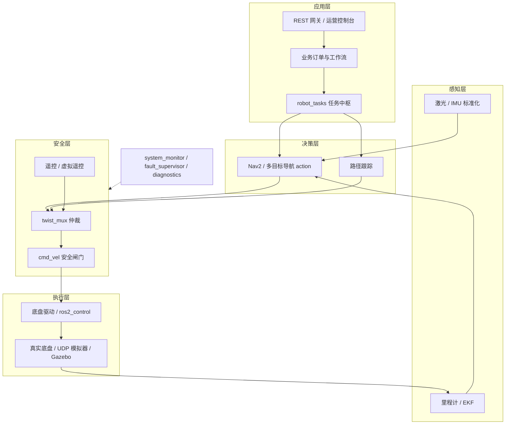

# ROS2_AMR 需求文档（需求基线与功能对照）

| 项目 | 内容 |
|---|---|
| 文档版本 | v1.0 |
| 编制日期 | 2026-11-26 |
| 代码基线 | `main@323764b` |
| 参考项目 | `~/lz_ws/robot`（本项目为其更新版本） |
| 适用范围 | 本仓库 `src/` 下 18 个 ROS 2 包、`tools/`、`docs/` |
| 关联文档 | `docs/学习顺序.md`、`docs/问题清单.md`、各包 `README.md` |

本文档替代已删除的旧需求文档，作为后续开发、复刻、验收和对外说明的基线。
文档只描述“应该具备什么能力、在哪里实现、如何验收”，具体缺陷与修复状态见
`docs/问题清单.md`。

---

## 0. 结论摘要

- 当前工程包含 **18 个 ROS 2 包、94 个 msg/srv/action 契约**，全部包可构建。
- 自动化基线：**18/18 包构建通过，537 个测试、0 失败、1 跳过**（跳过项为需要
  Gazebo/3D 显示的运行时用例）。
- 核心链路已实测通过：mock 底盘 → 传感器 → 速度仲裁/安全闸门 → 任务中枢 →
  导航/路径跟踪 → 实验输出 → REST 网关 → 端到端冒烟。
- 相对参考项目：**核心机器人功能保留并有增强**（测试数 416+ → 537，代码分层更
  清晰，接口按域拆包）；北向协议适配器已迁移，**但 110+ 验收脚本、Docker 环境、
  20 章文档与旧服务名兼容层仍未完整迁移**。
- 本轮已修复：REST 网关补齐 14 个端点、VDA/PLC/回调适配器迁移、`use_sim_time`
  贯通、依赖声明补齐、假激光可关闭、空闲日志降噪、站点配置 launch。
- 接口命名从参考项目的版本前缀式服务名改为 `<域>/*`，并移除了 legacy
  `robot_interfaces` 包。这是显式的破坏性变更，需要作为兼容性决策记录（见 5.2 与 11 节）。
- 本机为 VMware 虚拟机，EGL/OpenGL 3.3 不可用，Gazebo 仿真在本机无法启动；
  仿真子系统的运行时验证需在具备 GPU/EGL 的主机完成。

---

## 1. 项目定位与范围

### 1.1 项目目标

构建一套基于 **ROS 2 Jazzy + C++17** 的室内自主移动机器人（AMR）软件系统，覆盖：

1. 底盘通信（Mock / Serial / UDP）与 ros2_control 标准控制链路；
2. 激光、IMU 等传感器的标准化与诊断；
3. 速度指令仲裁、安全闸门、急停、系统健康与故障监督；
4. Nav2 / SLAM / 地图与语义区管理；
5. Pure Pursuit / Stanley 路径跟踪与实验指标；
6. 任务队列、站点运输、设施预约、充电、车队、订单路由与工作流；
7. Gazebo 仿真、两机器人场景、自动演示与可视化；
8. 北向 REST 网关、运营控制台、验收脚本与文档。

### 1.2 范围

**范围内：**

- `src/` 下 18 个包及其 launch、config、msg/srv/action、测试；
- `tools/` 下的规范检查、冒烟、REST 网关与操作台页面；
- `docs/` 下的需求、问题、学习与教学文档；
- 与参考项目的功能对照与迁移说明。

**范围外：**

- 真实底盘/激光/IMU 硬件的电气与机械设计；
- 云端车队管理平台、真实 MQTT Broker、真实 PLC 的部署；
- 生产环境的用户认证、权限系统、数据库与多租户；
- 完整 SLAM 算法与 Nav2 内部实现（本项目做配置与集成，不重写上游算法）。

### 1.3 更新原则（相对参考项目）

| 编号 | 原则 | 说明 |
|---|---|---|
| UP-01 | 功能不减少 | 参考项目已有的用户可见能力必须保留，或明确记录为“有意删除/替换” |
| UP-02 | 接口变更显式化 | 服务名、话题名、包名发生变化时，必须提供映射表与迁移说明 |
| UP-03 | 行为可验证 | 每个功能至少有一个可执行验收方式（gtest、launch_test、脚本、手工步骤） |
| UP-04 | 分层不放宽 | `nodes/` 只做装配，算法/流程/数据放在对应子目录；单文件 ≤ 1500 行 |
| UP-05 | 单一入口 | `/cmd_vel` 只有一个发布者；外部订单只有一个提交入口；一个消息类型只定义一次 |

---

## 2. 术语

| 术语 | 含义 |
|---|---|
| 包（package） | colcon 构建单元，本工程共 18 个 |
| 域（domain） | 接口包划分：core / navigation / mission / facility / fleet / business / site |
| 契约（contract） | `.msg` / `.srv` / `.action` 定义 |
| 安全链 | 指令来源 → twist_mux → 安全闸门 → `/cmd_vel` → 底盘 |
| 任务中枢 | `robot_tasks` 的 `mission_runner_node`，负责任务队列、工作流与设施协同 |
| 冒烟（smoke） | 通过真实服务调用串起“下单→暂停→恢复→快照”的端到端检查 |
| 门禁（gate） | 合并/交付前必须通过的构建、测试、规范或运行检查 |

---

## 3. 总体架构与硬约束

### 3.1 分层数据流

### 3.2 必须保持的全局约束

| 编号 | 约束 | 验收方式 |
|---|---|---|
| GC-01 | `/cmd_vel` 只有唯一发布者：`cmd_vel_safety_gate_node`（`use_twist_mux:=false` 时为 `cmd_vel_mux_node`） | `ros2 topic info /cmd_vel -v` 发布者数 = 1 |
| GC-02 | TF 主链唯一：`map → odom → base_footprint → base_link → 传感器/轮子`；`odom→base_footprint` 由 driver 或 EKF 独占发布 | `ros2 run tf2_tools view_frames` 无重复父节点 |
| GC-03 | 外部订单统一从业务入口进入，`order_type` 路由到同一任务链路 | 仅存在 `/business/submit_order` 一个订单入口 |
| GC-04 | 一个消息类型只在一个接口包中定义 | 全局按 basename 去重扫描无重复 |
| GC-05 | 禁止用 `sleep` 冒充任务成功 | 任务必须看到真实位姿/odom 收敛或明确失败 |
| GC-06 | 所有等待必须有超时；取消/暂停必须能落地 | 断流、无 action server 场景下任务失败而非卡死 |

---

## 4. 交付物、包与接口清单

### 4.1 18 个 ROS 2 包

| 阶段 | 包 | 层次 | 职责 | 关键入口 |
|---|---|---|---|---|
| 接口 | `robot_interfaces_core` | IDL | 机器人/底盘/任务/导航统计/跟踪误差 | 5 msg + 3 srv |
| 接口 | `robot_interfaces_navigation` | IDL | 地图区域、定位健康、安全状态、导航 action | 3 msg + 9 srv + 1 action |
| 接口 | `robot_interfaces_mission` | IDL | 任务、站点、停靠、充电、交通 | 27 srv |
| 接口 | `robot_interfaces_facility` | IDL | 门、电梯、载具、设施资源 | 1 msg + 16 srv |
| 接口 | `robot_interfaces_fleet` | IDL | 车队与远程任务 | 5 srv |
| 接口 | `robot_interfaces_business` | IDL | 订单、履约、场景、工作流、运营 | 21 srv |
| 接口 | `robot_interfaces_site` | IDL | 站点配置校验/激活/回滚 | 3 srv |
| 模型 | `robot_description` | 模型 | URDF/xacro、几何参数、RViz 配置 | `urdf/robot.urdf.xacro` |
| 工具 | `robot_utils` | 基础设施 | 数学/时间、话题常量、健康与故障监督 | `system_monitor_node`、`fault_supervisor_node` |
| 硬件 | `robot_hardware` | 执行 | 协议、后端、运动学、适配、ros2_control 插件 | `chassis_driver_node`、`robot_chassis_hardware` |
| 感知 | `robot_sensors` | 感知 | 激光/IMU 标准化、假扫描、诊断 | `laser_filter_node`、`imu_filter_node` |
| 安全 | `robot_teleop` | 安全 | 速度仲裁、急停、限速、人工接管 | `cmd_vel_stack.launch.py`、`cmd_vel_safety_gate_node` |
| 算法 | `robot_path_tracking` | 决策 | Pure Pursuit / Stanley / 参考路径 | `pure_pursuit_controller_node`、`stanley_controller_node` |
| 导航 | `robot_navigation` | 决策 | Nav2/SLAM/地图/语义区/安全状态 | `nav.launch.py`、`map_manager_node` |
| 仿真 | `robot_simulation` | 执行/演示 | Gazebo 世界、桥接、两机器人、可视化 | `sim.launch.py`、`amr_sim_demo_director_node` |
| 评测 | `robot_experiments` | 评测 | 跟踪误差、CSV/JSON 指标 | `experiment_runner_node` |
| 任务 | `robot_tasks` | 应用 | 队列、工作流、站点/设施/充电/车队/订单 | `mission_runner_node` |
| 编排 | `robot_bringup` | 编排 | 顶层 launch、参数集成、launch 测试 | `bringup.launch.py`、`amr_demo.launch.py` |

### 4.2 接口契约规模

| 包 | msg | srv | action | 小计 |
|---|---:|---:|---:|---:|
| `robot_interfaces_core` | 5 | 3 | 0 | 8 |
| `robot_interfaces_navigation` | 3 | 9 | 1 | 13 |
| `robot_interfaces_mission` | 0 | 27 | 0 | 27 |
| `robot_interfaces_facility` | 1 | 16 | 0 | 17 |
| `robot_interfaces_fleet` | 0 | 5 | 0 | 5 |
| `robot_interfaces_business` | 0 | 21 | 0 | 21 |
| `robot_interfaces_site` | 0 | 3 | 0 | 3 |
| **合计** | **9** | **84** | **1** | **94** |

### 4.3 工具与文档

| 资产 | 当前状态 | 说明 |
|---|---|---|
| `tools/check_conventions.py` | ✅ | 命名/行数/分层/扩展名门禁，支持 `--root` 与 `--strict` |
| `tools/smoke_mission.sh` | ✅ | 下单→暂停→恢复→快照，输出 `SMOKE PASSED` |
| `tools/operator_api.py` | ✅ | REST 网关，覆盖参考项目的 14 个端点 |
| `tools/front_end.html` | ✅ | 零依赖运营页面，覆盖 snapshot / 下单 / 暂停 / 恢复 / 取消 |
| `tools/smoke_operator_api.sh` | ✅ | 14 个 REST 端点冒烟（健康/车队/设施/事件/批量下单/重排/400） |
| `tools/adapters/*` | ✅ | VDA5050 file/MQTT/即时动作、PLC 文件适配器、外部回调 outbox 已迁移 |
| `scripts/` 验收体系 | ❌ | 参考项目 110+ 脚本与 `check_robot.sh` 未迁移，当前仅 2 个冒烟脚本 |
| `docker/Dockerfile` | ❌ | 参考项目提供环境复现镜像，当前缺失 |
| `docs/` | ⚠️ | 现有学习顺序 + 2 份教学文档 + 本文档 + 问题清单；参考项目 20 章文档未迁移 |

---

## 5. 接口契约需求（IR）

| 编号 | 需求 | 当前实现 | 状态 |
|---|---|---|---|
| IR-01 | 所有 msg/srv/action 归属唯一接口包，共 94 个 | 7 个接口包按域拆分 | ✅ |
| IR-02 | 字段必须有单位/取值范围/默认值说明，Doxygen 注释 | 接口文件已加 `# @file/@brief/@details` 与字段注释 | ✅ |
| IR-03 | 命名统一为 `<域>/<名称>`，禁止版本号前缀、`_srv/_pub/_sub` | 服务已改为 `/mission/*`、`/business/*`、`/fleet/*`、`/facility/*`、`/site/*`、`/navigation/*` | ✅ |
| IR-04 | 话题名必须来自 `robot_utils::topics::k*` 常量 | `topic_names.hpp` 已集中话题名 | ⚠️ 仅话题集中，服务名仍散落 |
| IR-05 | 服务名也应集中管理，避免跨包硬编码 | 目前服务名在任务节点、工具中直接写字符串 | ❌ 待补 |
| IR-06 | legacy `robot_interfaces` 包应与新包共存一个兼容窗口 | 当前已删除；10 个定义已迁移到 core/navigation/facility | ⚠️ 破坏性变更 |
| IR-07 | 接口只表达领域语义，不包含节点实现细节 | 已遵守 | ✅ |
| IR-08 | 一个消息类型只定义一次 | 已按域去重；参考项目 legacy 包中的 10 个定义不再重复 | ✅ |

### 5.1 当前服务命名（统一域前缀）

| 当前服务 | 说明 |
|---|---|
| `/business/submit_order` | 订单统一入口 |
| `/mission/list_events` | 任务事件 |
| `/mission/cancel_queued` | 取消排队任务 |
| `/business/get_operator_snapshot` | 运营快照 |
| `/fleet/list_robots` | 车队列表 |
| `/facility/list_resources` | 设施资源 |
| `/site/activate` | 站点配置激活 |
| `/navigation/*`（map_manager） | 地图定位评估 |
| `/facility/request_lift_session` | 电梯会话 |

> 参考项目使用带版本号前缀的旧服务名；当前统一为域前缀，未提供旧名别名。
> 完整映射需在兼容性方案确定后补齐。

### 5.2 兼容性决策（待确认）

参考项目保留了 `robot_interfaces` 兼容包，并提供
`check_robot_interfaces_legacy_usage.sh`。当前项目移除了该包并重命名全部服务。
两种方案二选一：

1. **声明破坏性变更**：在 README/CHANGELOG 中明确“旧客户端需迁移”，不再提供别名；
2. **提供兼容窗口**：恢复一个只做类型转发的轻量包，或在节点上增加旧服务名别名
   （注意不能复制定义，需用同一类型 + 额外服务名注册）。

---

## 6. 功能需求（FR）

状态说明：✅ 已验证（本次实测或现有测试覆盖）；🧪 已实现未实测；⚠️ 部分实现；
❌ 缺失。

### 6.1 底盘与硬件

| 编号 | 需求 | 实现位置 | 验收/证据 | 状态 |
|---|---|---|---|---|
| FR-HW-01 | Mock / Serial / UDP 三种后端可切换 | `robot_hardware/transport/*` | `bringup backend:=mock`、`ros2_control_hardware backend:=mock` | ✅ |
| FR-HW-02 | 文本与二进制协议编解码、跨消息缓冲、越界饱和 | `protocol/packet.cpp` | `chassis_packet_test` 通过 | ✅ |
| FR-HW-03 | 差速/麦轮运动学互算 | `kinematics/kinematics.cpp` | 单元测试与 mock 运动 | ✅ |
| FR-HW-04 | 底盘状态机、看门狗、指令限幅 | `system/adapter.cpp`、`chassis_driver_node` | `chassis_system_adapter_test`、运行日志 | ✅ |
| FR-HW-05 | `/odom` 与 `/wheel/odom` 唯一发布路径，清零下发底盘 | `chassis_driver_node` | 运行 `/odom`、`/chassis/clear_odometry` | ✅ |
| FR-HW-06 | ros2_control SystemInterface 插件接入 `diff_drive_controller` | `ros/hardware_interface.cpp` | `ros2_control_hardware.launch.py` 控制器 active | ✅ |
| FR-HW-07 | 轮径/轴距/轮距标定可配置 | `config/chassis_calibration.yaml` | 启动日志加载标定 | ✅ |
| FR-HW-08 | UDP 底盘模拟器 | `chassis_simulator_node` + launch | 未在本机实测 | 🧪 |
| FR-HW-09 | 串口 `EAGAIN` 容错、整帧写出、NaN/Inf 拦截 | `transport/serial_backend.cpp`、driver | 代码审查；无专项测试 | 🧪 |

### 6.2 传感器

| 编号 | 需求 | 实现位置 | 验收/证据 | 状态 |
|---|---|---|---|---|
| FR-SEN-01 | 激光角度裁剪、无效值转 inf/0、frame_id 归一化 | `laser/laser_filter_node.cpp` | 代码审查；可手工发布扫描验证 | 🧪 |
| FR-SEN-02 | 顺时针扫描反转并重写角度元数据 | 同上 | 代码审查；建议补 gtest | 🧪 |
| FR-SEN-03 | IMU 100D4 字节流解析（A5 5A、长度、校验和、跨消息缓冲） | `imu/imu_100d4_parser_node.cpp` | 代码审查；输入无仓库内发布者 | 🧪 |
| FR-SEN-04 | IMU 字段归一化、诊断与参数 | `imu/imu_filter_node.cpp` | 运行于仿真 launch | 🧪 |
| FR-SEN-05 | 合成扫描源用于无激光场景 | `sim/fake_scan_node.cpp` | `bringup` 中 `/scan` 正常发布 | ✅ |
| FR-SEN-06 | 传感器诊断项进入 `diagnostic_aggregator` | 两节点 | `/diagnostics` 可见 | ✅ |

### 6.3 安全链路

| 编号 | 需求 | 实现位置 | 验收/证据 | 状态 |
|---|---|---|---|---|
| FR-SAFE-01 | 三路速度源仲裁（nav2/tracking/teleop） | `robot_teleop/config/twist_mux.yaml` | 运行日志显示 3 个 topic handler | ✅ |
| FR-SAFE-02 | 仲裁输出 `/cmd_vel/muxed` → 安全闸门 → `/cmd_vel` | `cmd_vel_stack.launch.py` | `/cmd_vel` 发布者数 = 1 | ✅ |
| FR-SAFE-03 | 急停/解除严格分离，四方向测试 | `cmd_vel_safety_gate_node` | `cmd_vel_safety_test` 11 用例 | ✅ |
| FR-SAFE-04 | 线速度与角速度限幅独立生效 | `safety/cmd_vel_safety.hpp` | 单元测试 | ✅ |
| FR-SAFE-05 | 遥控 deadman：输入停止后 300 ms 内归零 | `virtual_rc_node` | 运行日志；建议专项测试 | 🧪 |
| FR-SAFE-06 | 接管锁有限超时，不永久屏蔽导航 | `twist_mux` lock + 心跳 | 配置 `timeout: 0.5` | ✅ |
| FR-SAFE-07 | 系统健康监控与故障监督形成急停闭环 | `system_monitor_node`、`fault_supervisor_node` | `test_fault_supervisor`、bringup 测试 | ✅ |
| FR-SAFE-08 | 健康数据有新鲜度判定，监控进程死亡进入 FAULT | `system_monitor_node` | launch 测试 | ✅ |

### 6.4 导航、SLAM 与地图

| 编号 | 需求 | 实现位置 | 验收/证据 | 状态 |
|---|---|---|---|---|
| FR-NAV-01 | Nav2 basic / advanced 两套参数 | `config/nav2_basic.yaml`、`nav2_advanced.yaml` | `nav.launch.py` 生命周期 active | ✅ |
| FR-NAV-02 | slam_toolbox / Cartographer / gmapping 三选一 | `launch/slam.launch.py` | slam_toolbox 配置存在；gmapping 分支依赖缺失包 | ⚠️ |
| FR-NAV-03 | AMCL + EKF 定位链 | `nav.launch.py`、`robot_hardware/config/ekf.yaml` | `hardware_ekf` 输出 `/odom` | ✅ |
| FR-NAV-04 | 地图目录、地图切换、语义区服务 | `map_manager_node` | 5 个 launch、9 个 srv | 🧪 |
| FR-NAV-05 | 语义区（keepout/speed_limit/preferred_lane）双通道消费 | `zone_catalog`、`zone_filter_masks` | `zone_*_test` 通过 | ✅ |
| FR-NAV-06 | 导航安全状态、定位健康、任务状态发布 | `map_manager_node`、`navigate_sequence_server` | bringup 测试断言 topic | ✅ |
| FR-NAV-07 | Nav2 不可用时任务明确失败，不静默成功 | `navigate_sequence_server_node` | launch 测试 | ✅ |

### 6.5 路径跟踪与实验

| 编号 | 需求 | 实现位置 | 验收/证据 | 状态 |
|---|---|---|---|---|
| FR-TRK-01 | Pure Pursuit 跟踪，曲率分母用实际预瞄距离 | `pure_pursuit_controller_node` | `tracking_math_test` | ✅ |
| FR-TRK-02 | Stanley 输出角速度 `ω = v·tan(δ)/L` | `stanley_controller_node` | 单元测试 | ✅ |
| FR-TRK-03 | 目标点选择、速度/曲率限幅、终点停止 | `core/tracking_math.hpp` | 单元测试 | ✅ |
| FR-TRK-04 | 跟踪误差 `/tracking/error` 带目标/实际速度 | 控制器 | `tracking.launch.py` 实测 CSV | ✅ |
| FR-TRK-05 | 实验输出 CSV/JSON（横向/航向误差、里程、时长） | `experiment_runner_node` | `/tmp/track.csv`、`/tmp/track.json` | ✅ |
| FR-TRK-06 | 实验结果包含平均/最大速度等完整指标 | 同上 | 当前 JSON 无平均/最大速度汇总 | ⚠️ |

### 6.6 任务中枢与工作流

| 编号 | 需求 | 实现位置 | 验收/证据 | 状态 |
|---|---|---|---|---|
| FR-MIS-01 | 任务队列、优先级、抢占、取消 | `mission_runner_node` + `mission_queue` | 37 个队列用例 | ✅ |
| FR-MIS-02 | 暂停/恢复/取消，取消清暂停集合 | `workflow_control`、`mission_runner` | `workflow_control_test` | ✅ |
| FR-MIS-03 | 失败恢复策略、超时重试、资源清理 | `mission_recovery_*` | recovery/cleanup 测试 | ✅ |
| FR-MIS-04 | 成本 / ETA / 电量估算 | `mission_estimator` | `mission_profile_test` | ✅ |
| FR-MIS-05 | 站点目录、站点路网、站点序列与运输 | `station_*` | 站点相关 5 个测试 | ✅ |
| FR-MIS-06 | 预检（地图/区域/定位/电量） | `mission_preflight` | 预检测试 | ✅ |
| FR-MIS-07 | 交通资源锁、路口锁、死锁检测 | `traffic_reservation` | 24 个交通用例 | ✅ |
| FR-MIS-08 | 操作员快照与事件日志 | `operator_snapshot`、`mission_event_log` | 冒烟快照成功 | ✅ |
| FR-MIS-09 | 行为树编排（任务启动/运行时/结果/恢复/资源清理） | `behavior/*` | 行为树测试 | ✅ |
| FR-MIS-10 | 站点配置校验/激活/回滚 | `site_config_manager_node` | 服务已实现；无 launch/验收 | 🧪 |

### 6.7 设施、充电、车队与业务

| 编号 | 需求 | 实现位置 | 验收/证据 | 状态 |
|---|---|---|---|---|
| FR-FAC-01 | 门/电梯/载具作为可预约资源，支持预约/释放/超时回退 | `facility_reservation`、`facility_workflow` | 设施测试 | ✅ |
| FR-FAC-02 | 门控与电梯会话状态机 | `facility_workflow` | `facility_workflow_test` | ✅ |
| FR-FAC-03 | 低电量回桩、机会充电、充电桩占用锁 | `mission_charging_workflow`、`dock_catalog` | 充电测试 | ✅ |
| FR-FAC-04 | 顶模块/载具动作执行 | `facility/*` 服务 | `execute_top_module_action` | 🧪 |
| FR-FAC-05 | 外部 PLC 文件适配器 | `tools/adapters/facility_plc_file_adapter.py` | 实测门动作 accepted+finished | ✅ |
| FR-FLT-01 | 机器人状态管理、车队站点任务分发 | `fleet_catalog`、`fleet_runtime_state` | 11 个车队用例 | ✅ |
| FR-FLT-02 | 远程任务状态更新 | `/fleet/update_remote_task` | 服务存在 | 🧪 |
| FR-BUS-01 | 统一订单入口，按 `order_type` 路由 | `submit_order_router` | 路由测试、冒烟 transport 订单 | ✅ |
| FR-BUS-02 | transport / station / station_transport / station_sequence 订单 | `mission_profile_builders` | 站点/运输测试 | ✅ |
| FR-BUS-03 | business / picking_wave / replenishment / milk_run / vda5050 / scenario | `submit_order_router` | 路由测试 | ✅ |
| FR-BUS-04 | 订单幂等、短拣、履约状态查询 | `business/*` 服务 | 服务存在；部分有测试 | ⚠️ |
| FR-BUS-05 | 外部回调 / Webhook 外发 | `tools/adapters/external_callback_outbox.py` | 实测 HTTP 200 后 outbox 状态 SENT | ✅ |
| FR-BUS-06 | VDA5050 订单接入（路由层） | `submit_order_router` | 路由测试 | ✅ |
| FR-BUS-07 | VDA5050 file / instant action / MQTT 桥 | `tools/adapters/vda5050_*.py` | 文件桥下单后进入 WAIT_LOAD；即时动作 factsheet 通过；MQTT 桥代码迁移 | ✅ |
| FR-BUS-08 | 场景任务与场景工作流 | `scenario_catalog`、`scenario_workflow` | 5 个场景测试 | ✅ |

### 6.8 仿真、可视化与评测

| 编号 | 需求 | 实现位置 | 验收/证据 | 状态 |
|---|---|---|---|---|
| FR-SIM-01 | Gazebo 室内仓储世界，xacro 生成并 SDF 校验 | `worlds/indoor_room.sdf.xacro`、`sim.launch.py` | `gz sdf -k` 通过 | ✅ |
| FR-SIM-02 | ROS-GZ bridge：时钟、cmd_vel、odom、scan、imu、camera | `sim.launch.py` | 参数桥完整 | 🧪 |
| FR-SIM-03 | 两机器人命名空间、各自 cmd_vel/odom/scan | 同上 | 代码与 launch 完整 | 🧪 |
| FR-SIM-04 | 站点/设施/语义区可视化与文字标签 | `amr_sim_visualizer_node`、`amr_sim_gazebo_entity_bridge_node` | 本机无法启动 Gazebo | 🧪 |
| FR-SIM-05 | 自动演示编排（下单→设施→充电→车队） | `amr_sim_demo_director_node` | 依赖 Gazebo | 🧪 |
| FR-SIM-06 | headless 模式可运行 | `gui:=false` | 本机 EGL/OpenGL 失败，进程段错误 | ❌ |
| FR-EXP-01 | 跟踪误差采集与 CSV/JSON | `experiment_runner_node` | `tracking.launch.py` 实测 | ✅ |
| FR-EXP-02 | 场景 benchmark 与吞吐/循环时间指标 | `robot_experiments` | 参考脚本未迁移；代码部分支持 | ⚠️ |
| FR-EXP-03 | 轨迹可视化 | `robot_experiments` | `visualization_msgs` 依赖存在 | 🧪 |
| FR-EXP-04 | 结果文件可复现、无本机绝对路径 | — | 历史结果含 `/home/ubuntu/...` | ❌ |

### 6.9 编排、运维与工具

| 编号 | 需求 | 实现位置 | 验收/证据 | 状态 |
|---|---|---|---|---|
| FR-OPS-01 | `display` / `bringup` / `tracking` / `amr_demo` 四个 launch | `robot_bringup/launch` | 前三个实测通过；`amr_demo` 受 GPU 限制 | ⚠️ |
| FR-OPS-02 | mock 最小闭环可跑通任务并真实移动 | `bringup.launch.py` | `/odom` 从 0 到 (1.33, 0.68) | ✅ |
| FR-OPS-03 | 顶层 launch 收拢、参数集成、`/cmd_vel` 唯一 | 四个 launch | 冒烟与运行检查 | ✅ |
| FR-OPS-04 | 整机诊断与 launch_testing | `robot_bringup/test` | 2 个 launch 测试 | ✅ |
| FR-OPS-05 | 规范门禁脚本 | `tools/check_conventions.py` | `--strict` 通过；错误 root 退出非 0 | ✅ |
| FR-OPS-06 | 端到端冒烟脚本 | `tools/smoke_mission.sh` | `SMOKE PASSED` | ✅ |
| FR-OPS-07 | REST 网关覆盖参考项目的 14 个端点 | `tools/operator_api.py` + `tools/smoke_operator_api.sh` | 冒烟通过（健康/车队/设施/事件/批量下单/重排/400） | ✅ |
| FR-OPS-08 | 运营控制台页面 | `tools/front_end.html` | 与参考页面端点一致；未做浏览器点击验收 | 🧪 |
| FR-OPS-09 | 统一验收入口 `check_robot.sh`（6 套件，约 100 个用例） | 参考 `scripts/check_robot.sh` | 当前未迁移 | ❌ |
| FR-OPS-10 | Docker 环境复现 | 参考 `docker/Dockerfile` | 当前未迁移 | ❌ |

---

## 7. 非功能需求（TR）

| 编号 | 需求 | 目标/验收 | 当前状态 |
|---|---|---|---|
| TR-01 | 全量构建通过 | 18/18 包，0 error / 0 warning | ✅ |
| TR-02 | 自动化测试 | `colcon test` 全绿；当前 537 用例、0 失败、1 跳过 | ✅ |
| TR-03 | 规范门禁 | `check_conventions.py --strict` 退出 0 | ✅ |
| TR-04 | 唯一速度发布者 / 唯一 TF 主链 | 运行时检查 | ✅ |
| TR-05 | 不静默成功 | 无 odom/无 Nav2 时任务失败 | ✅ |
| TR-06 | 超时与新鲜度 | 所有等待有界；健康数据有 freshness | ✅ |
| TR-07 | 日志级别合理 | 空闲状态不得周期性 WARN 刷屏 | ✅ 安全闸门/虚拟遥控改为首次 WARN，之后 DEBUG |
| TR-08 | 依赖声明完整 | `rosdep install` 即可补齐运行依赖 | ✅ 已补 bringup→simulation、hardware→description、navigation→cartographer_ros |
| TR-09 | 代码分层与规模 | `nodes/` 只装配；单文件 ≤ 1500 行 | ✅ 最大 1210 行 |
| TR-10 | Lint 门禁 | cpplint/copyright/xmllint 进入 `colcon test` | ❌ 声明但未注册 |
| TR-11 | 文档可追溯 | README 文档索引与实际文件一致；docs 入库 | ⚠️ `docs/` 已取消忽略但尚未 `git add`；README 索引已修正 |
| TR-12 | 结果可复现 | 实验产物不含本机绝对路径 | ❌ 历史结果含 `/home/ubuntu` |
| TR-13 | 仿真环境要求明确 | headless 需 GPU/EGL 或软件渲染方案 | ❌ 未在文档中说明 |
| TR-14 | 北向接口安全 | 默认仅绑定 127.0.0.1；可选鉴权 | ⚠️ 无鉴权，默认本地绑定 |
| TR-15 | 兼容性 | 旧服务名客户端可迁移或有别名 | ❌ 未提供 |
| TR-16 | 元数据规范 | 版本号非 0.0.0；维护者邮箱有效 | ❌ 18/18 为 `0.0.0` / `ubuntu@todo.todo` |

---

## 8. 与参考项目的功能对照

参考项目：`~/lz_ws/robot`（19 个包，含 legacy `robot_interfaces`；110+ 验收脚本）。
当前项目：本仓库（18 个包，94 接口，537 测试）。

| 能力域 | 参考项目资产 | 当前项目 | 结论 |
|---|---|---|---|
| 底盘协议 / Mock/Serial/UDP / 运动学 / ros2_control | `robot_hardware` | 保留；文件按 `protocol/transport/kinematics/system/ros` 重排 | ✅ 保持 |
| 传感器标准化 / 假扫描 / IMU 解析 | `robot_sensors` | 保留；无单元测试 | ✅ 保持（测试待补） |
| 速度仲裁 / 安全闸门 / 急停 / 诊断闭环 | `robot_teleop` + `robot_utils` | 保留；测试增加 | ✅ 保持 |
| Nav2 / SLAM / 地图 / 语义区 / EKF | `robot_navigation` | 保留；Cartographer 依赖已声明，gmapping 改为明确报错 | ✅ 基本保持 |
| 路径跟踪 / 误差 / benchmark | `robot_path_tracking` + `robot_experiments` | 保留；实验指标部分 | ✅ 保持 |
| 任务队列 / 工作流 / 行为树 / 恢复 | `robot_tasks` | 保留；`impl/` 拆分 5 个 `.inc` | ✅ 保持 |
| 站点 / 设施 / 充电 / 车队 / 订单 / 场景 | `robot_tasks` | 保留；服务名改为域前缀 | ✅ 保持 |
| VDA5050 订单路由 | `submit_order_router` | 保留 | ✅ 保持 |
| VDA5050 file / instant / MQTT 桥 | `scripts/vda5050_*.py` | `tools/adapters/vda5050_*.py` | ✅ 已迁移 |
| PLC 文件适配器 | `scripts/facility_plc_file_adapter.py` | `tools/adapters/facility_plc_file_adapter.py` | ✅ 已迁移/实测 |
| 外部回调 / Webhook | `scripts/external_callback_outbox.py` | `tools/adapters/external_callback_outbox.py` | ✅ 已迁移/实测 |
| REST 北向网关 | `scripts/rest_api_gateway.py`（729 行，14 个端点） | `tools/operator_api.py`（14 个端点） | ✅ 保持 |
| 运营控制台 | `tools/operator_console.html` | `tools/front_end.html` | ✅ 保持（端点一致） |
| 两机器人 Gazebo / 自动演示 / 可视化 | `robot_simulation` | 保留；本机 GPU 不可用 | ✅ 保持（未实测） |
| 场景化 benchmark | `robot_experiments` + scripts | 代码保留；脚本缺失 | ⚠️ 部分 |
| 统一验收 / 110+ 脚本 | `scripts/check_robot.sh` + `scripts/*.sh` | `smoke_mission.sh` + `smoke_operator_api.sh`；`check_robot.sh` 未迁移 | ⚠️ 部分 |
| Docker 复现 | `docker/Dockerfile` | 无 | ❌ 缺失 |
| 文档体系 | 20 章 `docs/ch*.md` + 教学文档 | 学习顺序 + 2 篇教学 + 本文档 + 问题清单 | ⚠️ 部分 |
| legacy `robot_interfaces` 兼容包 | 19 包中的兼容窗口 | 已删除，10 个定义迁移 | ⚠️ 破坏兼容 |
| 接口总数 | 104（含 10 个 legacy 重复） | 94（去重） | ✅ 去重 |
| 测试数量 | README 宣称 416+ | 537（0 失败 1 跳过） | ✅ 增强 |

**结论：** 核心机器人运行时能力未减少；减少的是“北向集成适配器、验收脚本体系、
Docker 与部分文档/兼容资产”。这与“功能不能少”的目标存在差距，需按
`docs/问题清单.md` 的 P1 项决策：**补迁移** 或 **在需求中明确降级**。

---

## 9. 验收门禁（Gate）

| 门禁 | 命令 | 通过标准 | 本次结果 |
|---|---|---|---|
| G0 环境 | `source /opt/ros/jazzy/setup.bash`；`gz sim --versions` | ROS/ Gazebo 可用 | ✅（Gazebo 8.15，但本机渲染不可用） |
| G1 构建 | `colcon build --base-paths src --symlink-install` | 18/18 成功，0 warning | ✅（1 min 35 s） |
| G2 测试 | `colcon test --base-paths src && colcon test-result --all` | 0 error / 0 failure | ✅（537 用例，1 skip） |
| G3 规范 | `python3 tools/check_conventions.py --strict` | 退出 0 | ✅ |
| G4 规范防假通过 | `python3 tools/check_conventions.py --root /tmp/nope` | 退出非 0 | ✅（exit 2） |
| G5 mock 闭环 | `ros2 launch robot_bringup bringup.launch.py backend:=mock` | 关键 topic/service 齐全，`/cmd_vel` 唯一 | ✅ |
| G6 任务闭环 | `/business/submit_order` 下发 transport 订单 | `/odom` 收敛到目标附近 | ✅（0,0 → 1.33,0.68） |
| G7 冒烟 | `tools/smoke_mission.sh` | 输出 `SMOKE PASSED` | ✅ |
| G8 跟踪 | `ros2 launch robot_bringup tracking.launch.py controller:=pure_pursuit use_mock_chassis:=true` | CSV/JSON 生成 | ✅（277 样本） |
| G9 导航 | `ros2 launch robot_navigation nav.launch.py` | 生命周期节点激活，无崩溃 | ✅（缺 TF/scan 告警属预期） |
| G10 ros2_control | `ros2 launch robot_hardware ros2_control_hardware.launch.py backend:=mock` | `diff_drive_controller` active | ✅ |
| G11 EKF | `ros2 launch robot_hardware hardware_ekf.launch.py backend:=mock` | `/odom` 有输出 | ✅ |
| G12 网关 | `tools/smoke_operator_api.sh` | 14 个端点全部通过 | ✅ |
| G13 仿真 | `ros2 launch robot_bringup amr_demo.launch.py gui:=false use_rviz:=false` | Gazebo 存活、自动任务完成 | ❌（EGL/OpenGL 段错误，本机环境） |
| G14 模型 | `xacro ... > /tmp/robot.urdf && check_urdf` | 解析成功 | ✅ |
| G15 兼容 | 旧服务名客户端/参考脚本可直接运行 | 无需修改 | ❌（未提供别名；适配器已改用新服务名） |
| G16 文档 | README 文档索引与实际一致；docs 入库 | 无悬空链接 | ⚠️ 索引已修正；`docs/` 仍未 `git add` |
| G17 适配器 | `vda5050_file_bridge` / `facility_plc_file_adapter` / `external_callback_outbox` | 订单/门动作/回调成功 | ✅ |

---

## 10. 交付物清单与状态

| 交付物 | 期望 | 当前 | 差距 |
|---|---|---|---|
| 18 个 ROS 2 包 | 全部可构建/测试 | ✅ | — |
| 94 个接口契约 | 按域拆分、注释完整 | ✅ | — |
| `tools/check_conventions.py` | 规范门禁 | ✅ | — |
| `tools/smoke_mission.sh` | 端到端冒烟 | ✅ | — |
| `tools/operator_api.py` + 页面 | 运营控制台 | ✅ | 端点完整；仍无鉴权 |
| `tools/smoke_operator_api.sh` | REST 端点冒烟 | ✅ | — |
| 北向协议适配器 | VDA/PLC/回调 | ✅ | 已迁移到 `tools/adapters/` |
| 110+ 验收脚本 | `check_robot.sh` 统一入口 | ❌ | 需迁移或明确降级 |
| Dockerfile | 环境复现 | ❌ | 需补 |
| 文档体系 | 需求/问题/学习/教学 | ⚠️ | 教学 2 篇 + 学习顺序；本文档 + 问题清单；其余待补 |
| 兼容窗口 | 旧服务名别名或 legacy 包 | ❌ | 需决策 |

---

## 11. 风险与待决策

| 编号 | 风险/决策 | 影响 | 建议 |
|---|---|---|---|
| R-01 | 北向适配器（VDA/PLC/回调）是否属于本期范围 | 已迁移到 `tools/adapters/` | ✅ 已解决（文件桥/PLC/回调实测） |
| R-02 | 旧服务名与 legacy 包是否保留兼容 | 旧脚本/客户端全部失效 | 选择“兼容别名”或“破坏性变更 + 迁移文档” |
| R-03 | 本机无 GPU/EGL，Gazebo 不可运行 | 仿真相关功能无法验收 | 在 GPU 主机验收；或在 launch 中提供无渲染降级 |
| R-04 | 110+ 脚本缺失 | 大量业务场景无回归保护 | 优先迁移 `check_robot.sh` 与高频用例 |
| R-05 | `docs/` 尚未纳入版本库（工作区已取消忽略，但仍为未跟踪文件） | 文档易丢失（本次已发生） | `git add docs/` 并提交，或单独文档仓库 |
| R-06 | 服务名未集中 | 改名时易漏 | 增加 `service_names.hpp` 或常量模块 |
| R-07 | lint 未注册 | 风格/版权问题无法门禁 | 在各包 CMake 注册 `ament_lint_auto` |
| R-08 | 依赖声明缺口 | `rosdep` 环境不完整 | ✅ 已补 3 处 `exec_depend`；gmapping 改为明确报错 |
| R-09 | 仿真时钟不一致 | 全量仿真下时间戳/TF 可能异常 | ✅ `mission_runner`/`amr_demo` 已接入 `use_sim_time` |
| R-10 | 历史结果/日志噪声 | 误导使用者、掩盖真实告警 | 日志已降噪；历史实验产物待清理 |

---

## 12. 变更记录

| 版本 | 日期 | 内容 |
|---|---|---|
| v1.0 | 2026-11-26 | 基于当前 `main@323764b` 重建需求基线；完成与参考项目的功能对照、验收门禁与风险登记 |
